# SharePlate — Rescue Food. Reduce Waste. Feed Communities.

[](https://shebuilds.dev)
[]()
[](https://mlh.io)
[](https://cloudinary.com)
[](https://firebase.google.com)
[](https://supabase.com)
[](https://pratitdedhia.github.io/SharePlate/)

> 🌐 **Live Deployed Demo:** [https://pratitdedhia.github.io/SharePlate/](https://pratitdedhia.github.io/SharePlate/)  
> 📖 **Project Journey & Hackathon Report (Notion):** [SharePlate — Hacktober HackDays 2026 Report](https://app.notion.com/p/SharePlate-Hacktober-HackDays-2026-Report-40471fac0e5c813cb0d3de560f29a8aa?source=copy_link) · Markdown source mirrored in [`docs/notion/`](docs/notion/00_index.md)  
> 📂 **GitHub Repository:** [https://github.com/pratitdedhia/SharePlate](https://github.com/pratitdedhia/SharePlate)

**SharePlate** is a full-stack, community-driven food rescue web application built for **Hacktober HackDays 2026** (organized by the SheBuilds Delhi Chapter and powered by Major League Hacking) under the **Tech for Social Good** track.

SharePlate bridges the critical communication gap between high-volume commercial food institutions (university canteens, banquet caterers, corporate cafeterias, and bakeries) and local community organizations (NGOs, community kitchens, shelter coordinators, and volunteer runners) to redistribute wholesome surplus food before it spoils.

---

## 🏛️ Deployed Demo vs. Production Architecture Notice

To provide instant, zero-friction evaluation for hackathon judges without requiring cloud credentials or infrastructure deployment:
- **Live Deployed Web App (`apps/web` on GitHub Pages):** Operates with `VITE_DEMO_MODE=true` using an in-browser transactional store (`demoStore`). It features a real, direct-to-Cloudinary image upload pipeline using unsigned upload presets, responsive image delivery (`srcset` at 400w/800w/1200w), food safety controls, and real measured bandwidth savings.
- **Firebase (Auth + Firestore):** Google Sign-In, Email/Password and live `onSnapshot` sync across devices run on the Firebase project configured in `apps/web/.env`.
- **In-Repo Production Architecture (`apps/api` + `supabase/`):** A complete Node.js/Express REST API and PostgreSQL database schema with Row Level Security (RLS) policies, cryptographic SHA-based upload signature endpoints (`/api/uploads/signature`), and concurrency-safe atomic stored procedures (`claim_donation_atomic`).

---

## 📸 Overview & Key Features

- **🔐 Role-Based Food Rescue Access:** Professional authentication flows with session persistence, inline error handling, and role-based redirects.
- **🔑 Dual Authentication (Google Sign-In & Email/Password):** Integrated Firebase Authentication supporting 1-click **Continue with Google** (via official Google Auth Provider popup) alongside traditional Email & Password with automatic Firestore profile creation and role assignment. Features intelligent `auth/unauthorized-domain` detection with setup guidance for deployed domains (like GitHub Pages) and zero-blockage fallbacks.
- **⚡ 1-Click Quick Demo Access:** Instant evaluation buttons for Judges on `/login` to continue immediately as Donor, Recipient, Volunteer, or Admin with seeded personas.
- **🛡️ Strict Role-Based Dashboards & Dynamic RBAC Navigation:** Purpose-built workflows with tailored navigation for all personas:
  - **Donor:** Interactive dashboard with clickable KPI stat cards (`Total Listings`, `Available Now`, `Claimed / Transit`, `Completed`, and `Donor Rewards Balance`) that dynamically filter listings, elevate volunteer handoff dispatch queues, and surface contextual feature banners with real-time search. Includes My Listings (`/my-donations`), and the **Donor Rewards Ledger**; Browse Food, Impact, and About links are strictly hidden.
  - **Recipient:** Dashboard with interactive stat cards and status filter pills (`All`, `Pickups`, `In Transit`, `Delivered`), Browse Food (`/donations`), and My Claims (`/my-claims`); Impact and About links are hidden. Claims view enforces zero-trust PIN secrecy: recipients see only their secret Delivery PIN and never the donor's Pickup PIN.
  - **Volunteer:** Dedicated 3-Tab *Last-Mile Food Rescue & Rewards Hub*:
    - **1. "On-My-Way" Commute Trip Planner:** Enter origin and destination, browse nearby rescue tasks along transit corridors (Delhi NCR, Mumbai, Pune presets), select tasks with checkboxes, review sequential stop orders, generate multi-stop Google Maps directions with waypoint partitioning (<= 9 waypoints per leg), and accept planned routes. Task board filters strictly for active recipient claims (`claimed` | `collected`), eliminating phantom or unreserved orders.
    - **2. Stop-by-Stop Checklist & Two-Party OTP Verification:** Step-by-step navigation checklist with unlocked dock instructions. Enforces strict two-party verification (`Available → Accepted → Pickup awaiting confirmation → In transit → Delivery awaiting confirmation → Delivered / Disputed`). 4-digit one-time codes generated upon arrival with 15-minute expiration and 3-attempt lockout. The donor restaurant verifies handover at pickup, and the recipient NGO confirms portions at delivery. Volunteer self-confirmation is strictly rejected.
    - **3. Volunteer Rewards & Points Ledger:** Transparent capped rewards formula (\(\min(150, 50 + 2 \times \text{portions})\)), pending vs. released points counters, milestone progression (Bronze Courier → Silver → Gold Champion), immutable audit history, and clear disclosure of future corporate sponsor voucher concepts.
  - **Donor Rewards System:** Persisted rewards ledger for food donors, awarded strictly upon verified NGO delivery confirmation (\(\min(200, 30 + 2 \times \text{portions})\)). Zero rewards for listings, reservations, pickups, cancellations, or disputes. Donors view points balance and verifiable delivery history.
  - **Superadmin Executive Command Center:** Overhauled, unified executive dashboard eliminating redundant navbar links. Features a dark gradient executive command strip, real-time Firestore sync status, interactive KPI stat cards with deep-links, 1-click role filter pills (`All`, `Donors`, `Recipients`, `Volunteers`, `Admins`), pan-India state oversight bypass, an urgent food safety alert banner, surplus inventory ledger, distribution claims with courier attribution, and complete safety reports moderation.
- **🏛️ State-Locked Registration & Strict Regional State Isolation:** User registration captures both Indian State and City (e.g. Maharashtra → Mumbai/Pune; Delhi → Delhi NCR). Recipient and Donor listings and active claims are strictly isolated by state, preventing out-of-state cross-claiming (e.g., Delhi recipients cannot claim Pune surplus). Platform Administrators hold strict global override access to audit and govern across all Indian states.
- **🚩 Restaurant Grievance & Issue Reporting with Admin Escalation:** Recipients and volunteers can file complaints directly from claim cards (covering food freshness/spoilage, portion mismatch, refused handover, unsanitary hygiene, or staff misconduct). Submitting immediately flags the claim and restaurant to platform administrators, displaying a prominent alert banner on the claim card and pushing an incident record into the Admin Safety Moderation Queue for investigation and formal warning issuance.
- **🔒 Two-Party Zero-Trust Verification (Zero-PIN Leakage):** Enforces strict two-party verification PIN separation: the donor kitchen holds a private 4-digit Pickup PIN (e.g. 4821) and the recipient shelter holds a private 4-digit Delivery PIN (e.g. 7392). The recipient portal never displays the donor PIN, and the donor never sees the recipient PIN. Volunteer couriers verify at each dock to finalize handovers.
- **🔍 Interactive Click-to-Inspect Food Cards:** Seamless navigation to listing details from card images, titles, and action buttons, presenting Cloudinary meal banners, ingredient disclosures, allergen tags, and real-time pickup countdown timers.
- **📋 Food Safety & Expiration Controls:** Prepared-at timestamps, consume-within hours, storage instructions, and veg/non-veg tags. Donations past pickup deadlines are automatically greyed out and protected against claims.
- **📸 Real Cloudinary Pipeline:**
  - Direct unsigned upload to Cloudinary via configured upload preset with client validation (JPEG/PNG/WebP, max 5 MB).
  - Server-signed upload endpoint ready when Express runs.
  - Dynamic transformations: `c_fill, g_auto, f_auto, q_auto`, responsive `srcset` (400w, 800w, 1200w), and `loading="lazy"`.
  - Real bandwidth savings measurement comparing original file size against the delivered transformed WebP blob.
  - Cloudinary provenance badge displayed strictly on images genuinely served from `res.cloudinary.com`.
- **🔒 Over-Claim & Expiration Protection:** In the deployed demo, `demoStore` prevents over-claiming and claiming expired batches. In the production backend, PostgreSQL stored procedures (`claim_donation_atomic` with `SELECT ... FOR UPDATE`) guarantee ACID concurrency safety.
- **🛡️ Privacy-Preserving Logistics:** Sensitive loading-dock access instructions and personal donor phone numbers are masked in public queries and revealed strictly to confirmed claimants.
- **🗺️ Regional Operating Cities & Dynamic Corridor Routing:** Automated regional scoping for **Mumbai**, **Delhi NCR**, **Pune**, **Noida**, and **Bengaluru**. Volunteers are immediately matched to regional transit corridors (e.g. Mumbai BKC → Kurla → Ghatkopar; Delhi Rohini → Connaught Place; Pune FC Road → Shivajinagar), and recipients/donors see localized listings.
- **🔄 Real-Time Cross-Role & Cross-Tab Synchronization:** Full reactive synchronization between donors, recipients, and volunteers across multiple browser tabs and devices via transactional `demoStore` reloads, BroadcastChannel, and custom window storage events. Profile & settings updates (name, organization, contact, city) instantly cascade into active headers, portal badges, and filter defaults across all dashboards.
- **📊 Unified Impact Math:** A single pure calculation engine (`apps/web/src/lib/impactMath.ts`) derives hero statistics, impact charts, and rescue rates (`delivered / listed * 100`). The funnel never contradicts the metrics.

---

## 🛠️ Technology Stack

| Layer | Technology | Details |
| :--- | :--- | :--- |
| **Frontend** | React 18, Vite, TypeScript, Tailwind CSS | Modular components, HashRouter for Pages compatibility, Rollup production bundle |
| **Media Cloud** | Cloudinary | Direct client upload preset, server signatures, auto-format (`f_auto`), smart crop (`g_auto`) |
| **Cloud & Realtime Backend** | Google Firebase | Cloud Firestore live database, multi-device `onSnapshot` real-time sync, Firebase Auth & Storage |
| **Production Backend** | Node.js 24 LTS, Express, TypeScript | REST API, Zod schema validation, Helmet security headers, CORS |
| **Production Database** | PostgreSQL 15+ (Supabase) | Multi-tenant Row Level Security (RLS), atomic stored procedures (`claim_donation_atomic`) |
| **Testing** | Vitest, Node.js Test Runner | 103 frontend tests (restaurant complaints & admin moderation queue, role-based OTP protection & zero-PIN leakage, state registration isolation & admin pan-India access, volunteer active orders filtering, donor rewards ledger, volunteer trip routing, two-party OTP verification, cross-portal sync, profile city persistence, impact math, auth & authorized domain fallback, upload fallback & error handling, features suite, render safety), 2 backend tests (105 total passed) |
| **Documentation** | Notion (Mandatory Hackathon Platform) | 12 structured markdown guides under `docs/notion/` |

---

## 📊 System Architecture & Workflow Visualizations

### 1. Dual-Runtime System Architecture

SharePlate operates on a resilient dual-runtime architecture: a client-side reactive frontend deployable to static hosts (GitHub Pages) with direct unsigned Cloudinary media pipelines and Google Firebase Cloud Firestore synchronization, backed by a production Express REST API and Supabase PostgreSQL with Row Level Security:

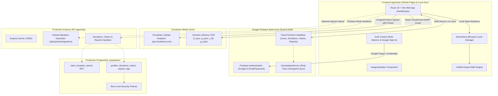

---

### 2. Cloudinary Media Pipeline Flow (Unsigned vs. Signed)

Food donors can upload surplus food photos directly from their browser on static deployments using an unsigned upload preset, or via cryptographic backend signatures when connected to the Express API:

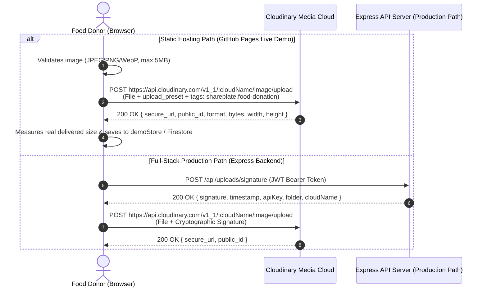

---

### 3. Two-Party Zero-Trust Verification Flow (Zero-PIN Leakage)

To eliminate phantom rescues and verify genuine handoffs, SharePlate implements a zero-trust two-party OTP system. Secrets are strictly isolated: **the recipient never sees the donor's pickup PIN**, and **the donor never sees the recipient's delivery PIN**:

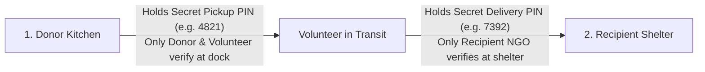

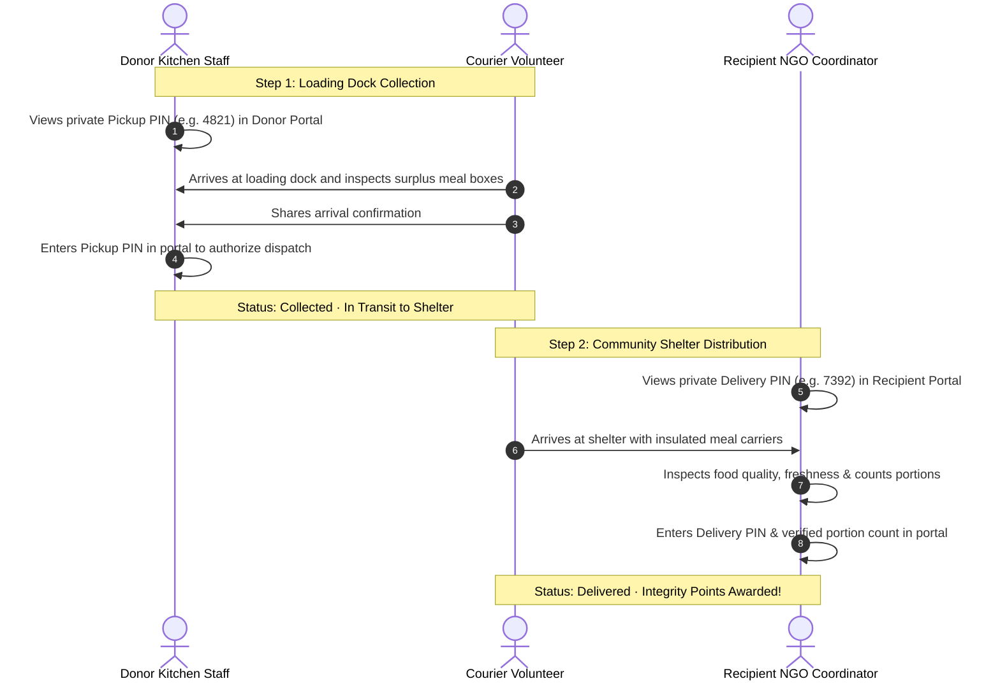

---

### 4. State-Locked Registration & Regional Listing Isolation

To prevent out-of-state claims and preserve food safety, non-admin users (Donors, Recipients, Volunteers) have their dashboards strictly isolated to their registered state. Platform Administrators retain pan-India governance access:

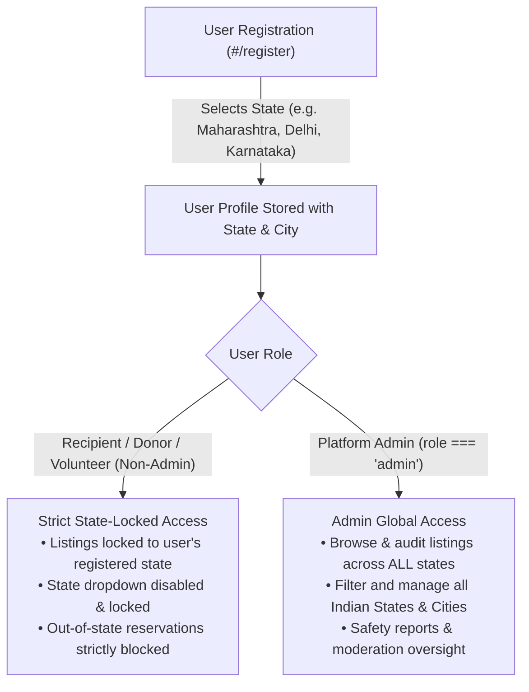

---

### 5. Regional Food Rescue Routing & Portal Scope

Every portal in SharePlate automatically adapts its operational scope to match the user's geographical region:

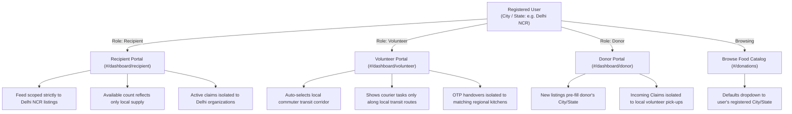

---

### 6. Transparent Donor Rewards & Quantity Bonus Calculation

Points are never granted on listing creation; they are minted **only after recipient inspection and delivery confirmation**, using a transparent, anti-inflation formula:

$$\text{Points Credited} = \min(200, 30 + (\text{portions} \times 2))$$

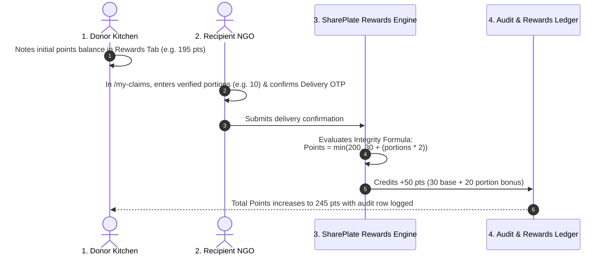

---

### 7. Restaurant Safety Grievance & Admin Moderation Queue Flagging

Recipients and volunteers can flag issues against donor restaurants directly from their claims view, creating an immediate alert in the Platform Admin moderation queue:

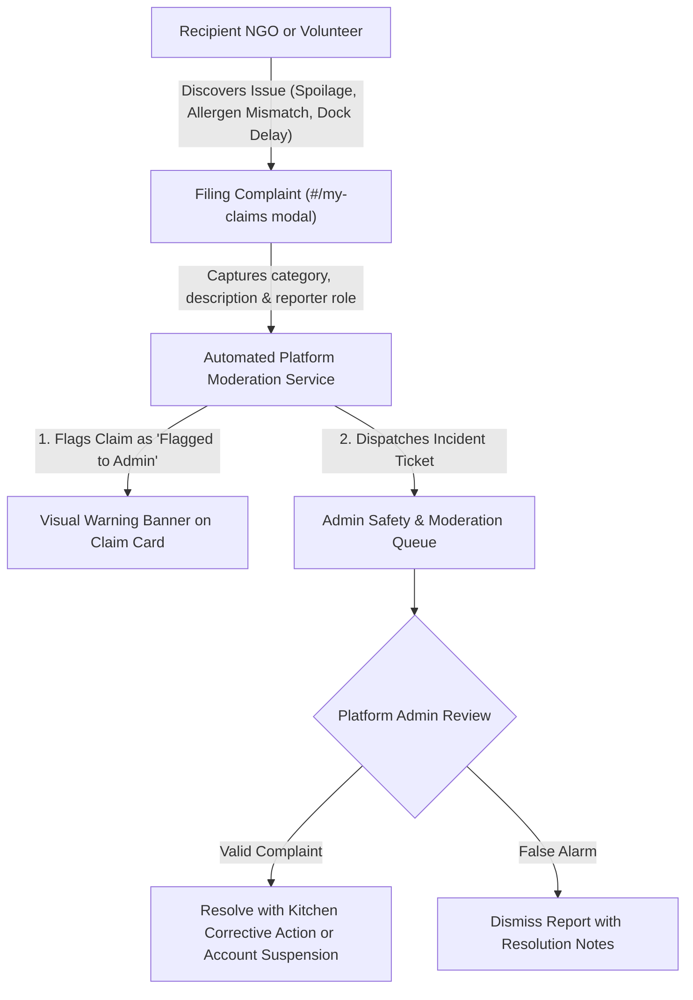

---

### 8. Volunteer Last-Mile Corridor Dispatch & Waypoint Routing Lifecycle

Volunteer couriers bundle multiple food rescue collections along their everyday commute corridors. The system enforces strict scoping: only genuine active recipient claims (`claimed` or `collected`) are surfaced, eliminating unreserved ghost orders:

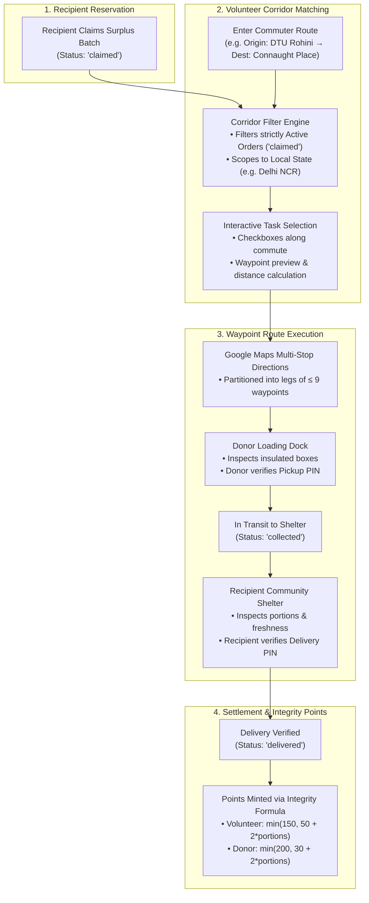

---

### 9. Superadmin Executive Command Center & Governance Workflow

The redesigned Superadmin Command Center unifies platform operations under a single, non-redundant dashboard navigation bar, empowering administrators to audit user roles, govern cross-state inventory, and moderate food safety disputes in real time:

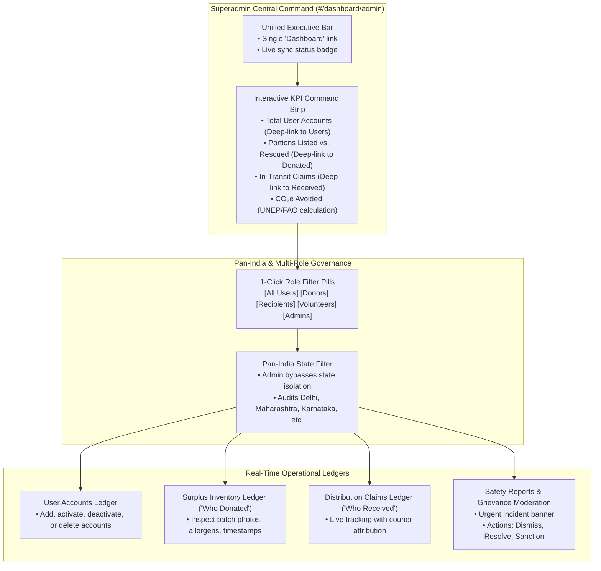

---

### 10. Resilient Hybrid Authentication & Domain Security Fallback

SharePlate balances enterprise Firebase OAuth security with immediate hackathon judge accessibility. When running on deployed domains (such as `pratitdedhia.github.io`), the client gracefully catches unauthorized-domain configurations and provides 1-click seeded persona fallbacks:

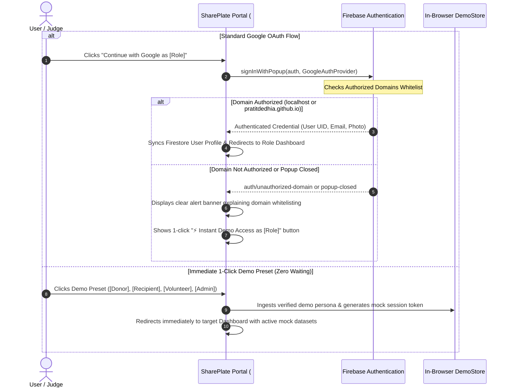

---

## ⚡ Quickstart & Local Installation

### Prerequisites
- Node.js (v20+ LTS recommended, v24 LTS verified)
- Git

### 1. Install Workspace Dependencies
```bash
# Clone the repository
git clone https://github.com/pratitdedhia/SharePlate.git
cd SharePlate

# Install all workspace dependencies
npm ci
```

### 2. Configure Environment Variables
Copy the example files:
```bash
cp apps/api/.env.example apps/api/.env
cp apps/web/.env.example apps/web/.env
```

#### Cloudinary Setup Guide (Unsigned Upload Preset for Browser Uploads)
SharePlate supports live browser uploads directly to Cloudinary CDN using **unsigned upload presets**. This architecture allows static hosts (such as GitHub Pages) to upload food donation images securely without exposing private Cloudinary API keys or secrets in client-side code.

Follow these steps in the Cloudinary Console:
1. **Locate your Cloud Name:** Sign in to your [Cloudinary Dashboard](https://cloudinary.com/console) and copy your **Cloud Name** (shown in the Product Environment / Dashboard overview).
2. **Create an Unsigned Preset:**
   - In Cloudinary, click the **Settings** (gear icon) in the bottom left or top navigation.
   - Select **Upload** from the settings menu.
   - Scroll down to the **Upload presets** section and click **Add upload preset**.
   - Under **Preset details**, set **Signing Mode** to **Unsigned** (crucial: signed presets reject direct browser requests).
   - Enter an **Upload preset name** (or use the generated name, e.g., `shareplate_unsigned`).
   - Under **Folder**, set `shareplate/donations` (or your preferred folder).
   - *(Optional)* Under **Media analysis and AI**, enable Google Auto-Tagging if available on your add-on plan.
   - Click **Save** in the top-right corner.
3. **Configure Local Environment (`apps/web/.env`):**
   ```env
   VITE_DEMO_MODE=true
   VITE_CLOUDINARY_CLOUD_NAME=your_actual_cloud_name
   VITE_CLOUDINARY_UPLOAD_PRESET=your_unsigned_preset_name
   VITE_NOTION_URL=https://app.notion.com/p/SharePlate-Hacktober-HackDays-2026-Report-40471fac0e5c813cb0d3de560f29a8aa?source=copy_link
   ```
4. **Configure Deployment Environment (GitHub Pages / CI):**
   - In your GitHub repository, navigate to **Settings > Secrets and variables > Actions > Variables** (tab: *Variables*).
   - Click **New repository variable** and add:
     - Name: `VITE_CLOUDINARY_CLOUD_NAME` / Value: your cloud name.
     - Name: `VITE_CLOUDINARY_UPLOAD_PRESET` / Value: your unsigned preset name.
   - GitHub Actions will inject these variables at build time during automated deployment.

> **Zero-Config Fallback & Demo Mode:**
> When credentials are not yet configured or left with `<<FILL...>>` placeholders:
> - The image uploader displays a clear pending configuration banner and keeps sample presets available.
> - Users can evaluate content-aware smart cropping (`c_fill, g_auto`) and dynamic formatting (`f_auto, q_auto`) using the pre-seeded evaluation assets.
> - Dropping or browsing a local photo falls back safely to labeled local object previews (`local_preview`) so testing continues uninterrupted.
> - If credentials are configured but the upload fails (e.g., misspelled preset or unsigned mode not enabled in dashboard), the UI validates and surfaces the error with actionable troubleshooting advice instead of silently hiding failures.

#### Firebase Environment & Firestore Real-Time Setup
SharePlate includes complete integration with Google Firebase for real-time Firestore database persistence, live multi-user `onSnapshot` synchronization across devices, and Firebase Authentication:

```env
VITE_FIREBASE_API_KEY=<your-firebase-web-api-key>
VITE_FIREBASE_AUTH_DOMAIN=<project-id>.firebaseapp.com
VITE_FIREBASE_PROJECT_ID=<project-id>
VITE_FIREBASE_STORAGE_BUCKET=<project-id>.firebasestorage.app
VITE_FIREBASE_MESSAGING_SENDER_ID=<sender-id>
VITE_FIREBASE_APP_ID=<app-id>
VITE_FIREBASE_MEASUREMENT_ID=<measurement-id>
```

> Firebase web config values identify your project and are not secrets, but access is controlled entirely by **Firestore Security Rules** and Auth. Copy the real values from *Firebase Console → Project settings → Your apps*. Test-mode Firestore rules are open and expire after 30 days, so tighten them before any real use.

##### Enabled Firebase Authentication Providers:
- **Google Sign-In:** 1-click authentication with official Google popup, integrated role selector (`Donor`, `Recipient`, `Volunteer`), and automatic Firestore user profile creation/synchronization.
- **Email & Password:** Secure credential-based sign-in and registration with role governance for Donors, Recipients, and Volunteers.

##### Provision Firestore & Seed Current Actual Data:
1. Open the [Firebase Console](https://console.firebase.google.com/) → your project → **Firestore Database**
2. Click **Create database** -> Choose **Start in test mode** -> Select your nearest region -> Click **Create**.
3. Run the automated seed script to populate users, donations, claims, and rescue tasks into Firestore:
```bash
npm run seed:firebase
```

### 3. Launch Development Servers
Open two terminal windows:

**Terminal 1 (Backend API):**
```bash
cd apps/api
npm run dev
# Express API starts on http://localhost:5000
```

**Terminal 2 (Frontend Web):**
```bash
cd apps/web
npm run dev
# Vite Web App starts on http://localhost:5173
```
Open **`http://localhost:5173`** in your browser.

---

## 🧪 Automated Testing & Verification

All 105 automated tests pass (103 frontend across 7 Vitest suites + 2 backend), verified on the latest `main`:

### Run Backend API Tests:
```bash
npm test --workspace=@shareplate/api
# Result: 2 passed, 0 failed (Health endpoint verification)
```

### Run Frontend Unit & Integration Tests:
```bash
npm test --workspace=@shareplate/web
# Result: 103 passed, 0 failed (App, Impact Math, Donor Rewards Ledger, Volunteer Multi-Stop Route Partitioning, Volunteer Active Orders Filter, Two-Party Pickup & Delivery OTP Flow, Cross-Portal Sync, State on Registration & Strict Regional State Listing Isolation, Restaurant Grievance & Admin Moderation Queue Flagging, Role-Based Authentication & Google Sign-In with Authorized Domain Fallback, Profile City Persistence, Upload Fallback & Error Handling, Features Suite, Render Safety)
```

### Run All Workspace Tests:
```bash
npm test
# Total: 105 passed, 0 failed (100% clean)
```

### Verify Production Compilation:
```bash
npm run build:web
# Compiles apps/web (tsc && vite build) and mirrors self-contained root index.html with exit code 0
```

---

## 🎬 Recommended 2–3 Minute Evaluation Demo Script

1. **Homepage & Mission Context:** Open `https://pratitdedhia.github.io/SharePlate/`. Review the mission statement, demonstration trust metrics (derived via single calculation engine), and food safety guidance.
2. **List Surplus Food (Donor):** Switch to the **Canteen / Donor** persona (Priya Sharma - DTU Campus). Click **+ Donate Food** (`#/donations/new`). Upload a photo via Cloudinary (or select an evaluation preset). Observe the smart content-aware auto-crop preview (`g_auto` across 4:3, 16:9, and 1:1) and real measured bandwidth savings. Enter portions of *Fresh Vegetable Biryani*, set dietary tag *Veg*, allergen tags, and a pickup deadline.
3. **State-Isolated Food Reservation (NGO):** Switch persona to **NGO / Recipient** (Rajesh Kumar - Robin Hood Army, Delhi Chapter). Browse `#/donations`. Notice that only Delhi NCR listings appear; out-of-state listings (like Pune bread loaves) are isolated and protected. Claim 20 portions. Observe the available count decrement in real time.
4. **Active Orders Corridor Routing (Volunteer):** Switch to **Volunteer Courier** (Ananya Sen - Youth For Food Relief). Open **Trip Planner** tab (`#/dashboard/volunteer`). Select the commute corridor (e.g. DTU Rohini → Connaught Place). Notice the task checklist surfaces *only* active, reserved claims (`claimed` | `collected`), eliminating ghost orders. Select the tasks, inspect the sequential stop order, and click **Open Route in Google Maps** (handles waypoint partitioning for legs $>9$ stops).
5. **Two-Party OTP Handover (Zero-PIN Leakage):**
   - At pickup, the volunteer arrives at the loading dock. Switch to **Donor** (`#/dashboard/donor`) to view the private 4-digit **Pickup PIN** (e.g. `4821`) and authorize handover.
   - In transit, the status updates to `collected`.
   - At delivery, the volunteer arrives at the community shelter. Switch to **Recipient** (`#/dashboard/recipient` or `#/my-claims`). Notice the recipient sees *only* their private **Delivery PIN** (e.g. `7392`) and *never* the donor's pickup PIN. Verify portions and confirm the delivery OTP.
6. **Safety Complaint & Escalation:**
   - On a delivered claim in `#/dashboard/recipient` or `#/my-claims`, click **Report Issue / Complaint**.
   - Select an issue category (e.g. *Food Temperature / Hygiene*) and submit. An alert banner immediately marks the claim card as *Flagged to Admin*.
7. **Overhauled Executive Admin Command Center:**
   - Click the single unified **Dashboard** link as Admin (`#/dashboard/admin`).
   - Review the dark gradient command strip with live sync status.
   - Use the 1-click **Role Filter Pills** (`All`, `Donors`, `Recipients`, `Volunteers`, `Admins`) to filter registered users.
   - Inspect the **Urgent Safety Alert Banner** displaying the newly flagged restaurant incident.
   - Open the **Safety Reports & Moderation** tab to review the incident, inspect details, and resolve or dismiss it with administrative audit notes.
8. **Donor Rewards & Impact Dashboards:**
   - Switch back to **Donor** and review the **Donor Rewards Ledger** (`#/dashboard/donor`) to see points awarded strictly upon recipient delivery confirmation.
   - Open `#/impact`. Show the real-time portion funnel updating and the CO₂e avoided metric recalculating dynamically based on FAO/UNEP factors.

---

## 📁 Repository Structure

```
SharePlate/
├── .github/
│   └── workflows/
│       └── deploy-pages.yml    # GitHub Pages CI/CD workflow
├── apps/
│   ├── web/                    # React 18, Vite, Tailwind CSS, TypeScript frontend
│   │   ├── src/
│   │   │   ├── components/     # UI components (CloudinaryImage, ImageUploader, DemoModeBanner, etc.)
│   │   │   ├── contexts/       # AuthContext, ToastContext
│   │   │   ├── lib/            # cloudinary.ts, impactMath.ts, mockData.ts, utils.ts
│   │   │   ├── pages/          # Pages: Home, Browse, Detail, Create, Claims, Impact, Admin, Profile, auth, dashboards
│   │   │   ├── routes/         # ProtectedRoute, RoleGuard, AppRoutes
│   │   │   ├── services/       # donations, claims, impact, uploads API services
│   │   │   └── tests/          # Vitest suites (auth, claimFlow, features, impactMath, renderPage, uploadsFallback) + App.test.tsx
│   │   ├── .env.example
│   │   └── package.json
│   └── api/                    # Node.js, Express, TypeScript, Zod REST API
│       ├── src/
│       │   ├── config/         # env.ts, supabase.ts, cloudinary.ts
│       │   ├── middleware/     # auth.ts, rbac.ts, validate.ts, errorHandler.ts
│       │   ├── routes/         # health, uploads, donations, claims, impact, profile, reports
│       │   └── validators/     # Zod request validation schemas
│       ├── tests/              # Node.js test runner suite (api.test.js)
│       ├── .env.example
│       └── package.json
├── legacy/
│   └── index.html              # Preserved legacy single-file demo (archived)
├── supabase/
│   ├── schema.sql              # Complete PostgreSQL schema (tables, RLS, atomic RPCs, triggers)
│   ├── seed.sql                # Realistic Indian demo dataset (Mumbai, Delhi, Pune, Noida)
│   └── migrations/             # Timestamped migration mirror
├── docs/
│   ├── DEMO_SCRIPT.md          # 3-minute demo script & judge Q&As
│   ├── NOTION_SUBMISSION_CHECKLIST.md # Notion import & submission instructions
│   ├── api.md, architecture.md, authentication.md, database.md
│   ├── cloudinary.md           # Mandatory Cloudinary integration evidence
│   ├── deployment.md, security.md, testing.md
│   ├── demo-accounts.md, registration.md, role-based-access.md
│   ├── team-contributions.md   # Team task breakdown with verifiable contributions
│   └── notion/                 # Notion-ready report pages (00–12)
├── CHANGES.md                  # Comprehensive record of all changes, test logs & manual steps
├── .env.example
├── .gitignore
├── LICENSE
└── package.json
```

---

## 🚧 Limitations & Production Roadmap

While SharePlate provides an end-to-end interactive experience in demo mode and complete backend code in the monorepo, real-world deployment requires the following operational milestones:

1. **Transactional OTP & SMS Gateway:** Integrate Twilio or Fast2SMS so volunteer couriers and canteen managers receive instant SMS/WhatsApp alerts for pickups without requiring an open web browser.
2. **Official NGO Verification:** In the demo, NGOs register with self-reported 80G/FCRA IDs. Production requires integrating with government registry APIs (NGO Darpan) for KYC verification.
3. **Dynamic Traffic Matrix Optimization:** SharePlate generates sequential multi-stop Google Maps routes with automatic waypoint partitioning (handling Google Maps limits). Future releases will integrate real-time traffic matrix APIs to dynamically re-order waypoints based on live traffic congestion.
4. **Production Cloud Deployment of Express + Supabase:** Host `apps/api` on Render/Fly.io and connect with a production Supabase PostgreSQL instance with automated backups and read-replicas.
5. **Firestore Security Rules Hardening:** Replace test-mode rules with role-scoped rules before onboarding real users.
6. **Multilingual Localization (i18n):** Expand UI and donor submission forms into Hindi, Marathi, Tamil, and Bengali to support diverse regional canteen staff and grassroot volunteers.

---

## 🛡️ Food Safety Disclaimer

SharePlate is a community coordination technology platform. **SharePlate does not physically inspect, store, or certify food safety.**
- **Donors** are legally responsible under FSSAI regulations for accurate ingredient disclosures, declared allergens, and truthful preparation timestamps.
- **Recipients & Volunteers** must verify visual condition, odor, and temperature upon pickup, and distribute meals in accordance with local hygiene guidelines.

---

## 👥 Team

**Pratit Dedhia** ([@pratitdedhia](https://github.com/pratitdedhia)) — repository owner and lead developer.

| Area | Owner | Key files |
| :--- | :--- | :--- |
| Frontend engineering & Cloudinary integration | _add name_ | `apps/web/src/`, `lib/cloudinary.ts` |
| Backend architecture & security | _add name_ | `apps/api/src/` |
| Database engineering & concurrency | _add name_ | `supabase/` |
| QA, documentation & Notion report | _add name_ | `apps/web/src/tests/`, `docs/` |

Full task breakdown: [docs/team-contributions.md](docs/team-contributions.md).

---

## 📄 License

This project is licensed under the [MIT License](LICENSE) for Hacktober HackDays 2026.
