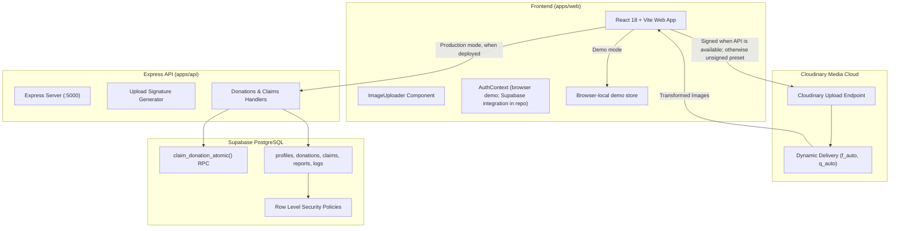

# SharePlate — Rescue Food. Reduce Waste. Feed Communities.

[](https://shebuilds.dev)
[]()
[](https://mlh.io)
[](https://cloudinary.com)
[](https://supabase.com)

**Project Journey (Notion):** <<FILL: public Notion page URL>>

**SharePlate** is a community food-rescue prototype built for **Hacktober HackDays 2026** (SheBuilds Delhi, powered by Major League Hacking). The GitHub Pages target is the React app in `apps/web`; the Pages workflow builds it in demo mode. Supabase and Express are present in the repository as the production architecture, but are not deployed for the demo.

SharePlate bridges the critical communication gap between high-volume commercial food institutions (university canteens, banquet caterers, corporate cafeterias, and bakeries) and local community organizations (NGOs, community kitchens, shelter coordinators, and volunteer runners) to redistribute wholesome surplus food before it spoils.

---

## 📸 Overview & Key Features

- **Demo workflows:** Sample donor, recipient, volunteer, and admin accounts exercise the app. Demo listings and claims are stored in the browser.
- **Role-based views:** The React app includes donor, recipient, volunteer, and admin dashboards. Express authorization is part of the repository architecture but is not deployed with the Pages demo.
- **📋 Dynamic Role Onboarding:** Multi-role registration (`/register`) with interactive cards and conditional fields for canteens, NGOs, and couriers without state loss. Self-registration as Administrator is strictly barred.
- **Donation listings and claims:** Demo actions update the local browser store; a local reset restores the seeded data.
- **Cloudinary image path:** With a cloud name and unsigned upload preset configured, the static demo uploads directly to Cloudinary. If the Express signature API is running and configured, signed upload is tried first. Without either, uploads are clearly labeled local previews.
- **Production claim path:** The Supabase schema includes `claim_donation_atomic`; it is not used by the deployed demo and does not imply cross-device protection in demo mode.
- **Impact snapshot:** Home and Impact use the same data calculation. Rescue rate is delivered portions divided by listed portions; food-weight and emissions figures are estimates.

---

## 🛠️ Technology Stack

| Layer | Technology | Details |
| :--- | :--- | :--- |
| **Frontend** | React 18, Vite, TypeScript | Fast HMR, modular component architecture, Rollup production bundle |
| **Styling** | Tailwind CSS | Curated social-good palette (Forest Green `#14532D`, Warm White `#FAF9F6`) |
| **Backend API** | Node.js, Express, TypeScript | Repository implementation; not deployed for the Pages demo |
| **Database** | PostgreSQL via Supabase | Repository schema includes RLS and production atomic stored procedures |
| **Authentication** | Demo auth in browser; Supabase Auth integration in repository | Cloud production auth is not deployed for the Pages demo |
| **Media & Images** | Cloudinary | Direct unsigned preset uploads in static demo; signed uploads when the API is configured |
| **Testing** | Vitest, Node.js Test Runner | Unit tests and API tests; see `CHANGES.md` for the checks observed for this revision |
| **Documentation** | Notion-ready Markdown | Source pages are in `docs/notion/`; publishing the public Notion page remains a manual step |

---

## 🏗️ Architecture Diagram



---

## ⚡ Quickstart & Local Installation

### Prerequisites
- Node.js 20 or newer
- Git

### 1. Install Workspace Dependencies
```bash
# Clone the repository
git clone https://github.com/pratitdedhia/SharePlate.git
cd SharePlate

# Install all workspace dependencies from the lockfile
npm ci
```

### 2. Configure Environment Variables
Copy the example files in both workspaces:
```bash
cp apps/api/.env.example apps/api/.env
cp apps/web/.env.example apps/web/.env
```
`VITE_DEMO_MODE=true` runs the browser-local demo. Real Cloudinary uploads require the public cloud name and unsigned preset. Express and Supabase are not required for the demo flow.

### 3. Launch Development Servers
Open two terminal windows:

**Terminal 1 (Backend API):**
```bash
cd apps/api
npm run dev
# Express API starts on http://localhost:5000
```

**Terminal 2 (Frontend Web):**
```bash
cd apps/web
npm run dev
# Vite Web App starts on http://localhost:5173
```
Open **`http://localhost:5173`** in your browser.

---

## 🧪 Automated Testing & Verification

Run the current checks locally from the repository root:

### Run tests and builds:
```bash
npm test
npm run build:web
npm run build:api
```

Observed results for this revision are recorded in [CHANGES.md](CHANGES.md), without substituting expected results for checks that could not be run.

---

## 🎬 Recommended 2–3 Minute Evaluation Demo Script

Use [docs/DEMO_SCRIPT.md](docs/DEMO_SCRIPT.md) for the demo flow and setup caveats. Cloudinary upload requires the public cloud name and unsigned preset repository variables; without them the uploader only creates a labeled local preview.

---

## 📁 Repository Structure

```
shareplate/
├── apps/
│   ├── web/                    # React 18, Vite, Tailwind CSS, TypeScript frontend
│   │   ├── src/
│   │   │   ├── components/     # UI components (common, donations, claims, impact)
│   │   │   ├── contexts/       # AuthContext, ToastContext
│   │   │   ├── lib/            # supabase.ts, cloudinary.ts, mockData.ts, utils.ts
│   │   │   ├── pages/          # 13 complete pages (Home, Browse, Detail, Create, Claims, Impact, etc.)
│   │   │   ├── routes/         # ProtectedRoute, RoleGuard, AppRoutes
│   │   │   └── services/       # donations, claims, impact, uploads API services
│   │   ├── .env.example
│   │   └── package.json
│   └── api/                    # Node.js, Express, TypeScript, Zod REST API
│       ├── src/
│       │   ├── config/         # env.ts, supabase.ts, cloudinary.ts
│       │   ├── middleware/     # auth.ts, rbac.ts, validate.ts, errorHandler.ts
│       │   ├── routes/         # health, uploads, donations, claims, impact, profile, reports
│       │   └── validators/     # Zod request validation schemas
│       ├── tests/              # Node.js test runner suite
│       ├── .env.example
│       └── package.json
├── supabase/
│   ├── schema.sql              # Complete PostgreSQL schema (tables, RLS, atomic RPCs, triggers)
│   ├── seed.sql                # Realistic Indian demo dataset (Mumbai, Delhi, Pune, Noida)
│   └── migrations/             # Timestamped migration mirror
├── docs/
│   ├── authentication.md       # Comprehensive login, session, and recovery guide
│   ├── registration.md         # Multi-role registration & conditional field specs
│   ├── role-based-access.md    # RBAC matrix, route guards, and RLS policies
│   ├── demo-accounts.md        # 1-click judge evaluation personas and reset steps
│   ├── architecture.md         # System architecture & Mermaid flowcharts
│   ├── database.md             # ER diagrams, table schemas, and concurrency locks
│   ├── api.md                  # REST API contract and endpoint documentation
│   ├── cloudinary.md           # Mandatory Cloudinary integration evidence
│   ├── security.md             # Threat modeling & security mitigation
│   ├── testing.md              # QA test plan & automated execution logs
│   ├── deployment.md           # GitHub Pages demo and production architecture setup
│   ├── team-contributions.md   # 4-member task allocation & contribution breakdown
│   ├── notion-documentation-outline.md
│   └── notion/                 # Notion-ready Markdown source pages
├── scripts/
│   └── reset-demo-data.js      # Idempotent demo data restorer
├── .env.example
├── .gitignore
├── LICENSE
└── package.json
```

---

## 📑 Demo And Production Paths

> The deployed demo and production architecture are different paths. Supabase and Express code in this repository is not deployed with the GitHub Pages site.

### Authentication & Authorization System Design
- **Architecture Philosophy:** Adopts the design rigor, input validation, and access isolation of enterprise hospital and care-management portals, mapped directly onto food rescue operations.
- **Demo identity:** Demo users are selected in the browser and are not verified against a deployed Supabase service.
- **Production identity path:** Supabase Auth and Express middleware are present in the repository; their deployment is a roadmap item.
- **4 Dedicated Operational Portals:**
  - **Donor (`/dashboard/donor`):** Kitchen surplus management, batch publishing, active claims monitoring, and collection confirmation.
- **Recipient (`/dashboard/recipient`):** Demo listing discovery, browser-local portion reservations, pickup deadline timers, and delivery status updates.
- **Volunteer (`/dashboard/volunteer`):** Demo dispatch board, pickup instructions, and delivery status updates.
- **Administrator (`/dashboard/admin`):** Demo views for metrics, reports, and user controls.
- **Judges Quick Demo Authentication:** Four 1-click access buttons on `/login` authenticate instantly as fictional seeded personas (Priya Sharma - DTU Canteen, Rajesh Kumar - Robin Hood Army, Ananya Sen - Youth For Food Relief, Ops Admin - SharePlate Foundation) and route to the corresponding dashboard.
- **Evaluation reset:** `npm run db:reset-demo` runs the repository reset script; browser-local demo data can also be cleared from browser storage.

---

## 🛡️ Factual Food Safety Guidance

SharePlate is a community coordination platform designed to eliminate food waste. **SharePlate does not inspect or certify food safety.**
- **Donors** are solely responsible for accurate ingredient disclosures, declared allergens, and truthful preparation timestamps.
- **Recipients** must verify sensory condition and temperature upon collection and distribute food in compliance with local food safety guidelines.

---

## 👥 Team Contributions (Confirm Before Submission)

- **<<FILL: real name>>:** TODO: confirm which frontend files and changes they authored.
- **<<FILL: real name>>:** TODO: confirm which API and validation changes they authored.
- **<<FILL: real name>>:** TODO: confirm which Supabase and Cloudinary changes they authored.
- **<<FILL: real name>>:** TODO: confirm which tests and documentation they authored.

## Limitations & Roadmap

- Deploy Supabase and the Express API, then connect the UI to shared production data.
- Add real OTP/SMS verification and NGO verification.
- Add route optimization for volunteer pickups.
- Add multilingual UI and content.

---

## 📄 License

This project is licensed under the [MIT License](LICENSE) for Hacktober HackDays 2026.
# SharePlate

