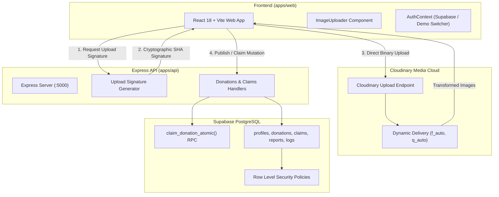

# SharePlate — Rescue Food. Reduce Waste. Feed Communities.

[](https://shebuilds.dev)
[]()
[](https://mlh.io)
[](https://cloudinary.com)
[](https://supabase.com)

**SharePlate** is a full-stack, community-driven food rescue web application built for **Hacktober HackDays 2026** (organized by the SheBuilds Delhi Chapter and powered by Major League Hacking).

SharePlate bridges the critical communication gap between high-volume commercial food institutions (university canteens, banquet caterers, corporate cafeterias, and bakeries) and local community organizations (NGOs, community kitchens, shelter coordinators, and volunteer runners) to redistribute wholesome surplus food before it spoils.

---

## 📸 Overview & Key Features

- **🚀 60-Second Surplus Food Posting:** Canteens specify portion counts, food category, preparation timestamp, allergen tags, and future pickup deadlines.
- **📸 Mandatory Cloudinary Pipeline:** Cryptographically signed browser uploads (`/api/uploads/signature`) with live upload progress, client-side preview, automatic responsive cropping (`c_fill, w_800`), and modern format delivery (`f_auto, q_auto`).
- **🔒 ACID Atomic Reservations:** Concurrency-safe PostgreSQL stored procedures (`claim_donation_atomic`) prevent double-reserving or overselling batches under concurrent demand.
- **🛡️ Privacy-Preserving Logistics:** Sensitive loading-dock access instructions and personal donor phone numbers are masked in public queries and revealed strictly to confirmed claimants.
- **📊 Defensible Live Impact Metrics:** Dynamically aggregates meals listed, reserved, and actually delivered. Computes CO₂e emissions avoided based on UNEP and FAO food waste benchmarks without fabricating statistics.
- **👥 Role-Aware Dashboards:** Dedicated operational views tailored to Donors, NGOs, Volunteers, and Platform Administrators.
- **⚡ Instant Hackathon Demo Mode:** One-click persona switcher allows judges to evaluate all role perspectives without manual database seeding or authentication friction.

---

## 🛠️ Technology Stack

| Layer | Technology | Details |
| :--- | :--- | :--- |
| **Frontend** | React 18, Vite, TypeScript | Fast HMR, modular component architecture, Rollup production bundle |
| **Styling** | Tailwind CSS | Curated social-good palette (Forest Green `#14532D`, Warm White `#FAF9F6`) |
| **Backend API** | Node.js 24 LTS, Express, TypeScript | REST API, Zod schema validation, Helmet security headers, CORS |
| **Database** | PostgreSQL 15+ (Supabase) | Multi-tenant Row Level Security (RLS), atomic stored procedures, triggers |
| **Authentication** | Supabase Auth | Secure email/password auth, JWT verification, role-based access control |
| **Media & Images** | Cloudinary | Server-signed direct browser uploads, dynamic transformations, CDN delivery |
| **Testing** | Vitest, Node.js Test Runner | Unit testing, portion math validation, endpoint health checks |
| **Documentation** | Notion (Mandatory Platform) | 12 complete structured markdown guides under `docs/notion/` |

---

## 🏗️ Architecture Diagram



---

## ⚡ Quickstart & Local Installation

### Prerequisites
- Node.js (v20+ LTS recommended, v24 LTS verified)
- Git

### 1. Install Workspace Dependencies
```bash
# Clone the repository
git clone https://github.com/your-team/shareplate.git
cd shareplate

# Install dependencies for both apps
npm install --workspace=@shareplate/api
npm install --workspace=@shareplate/web
```

### 2. Configure Environment Variables
Copy the example files in both workspaces:
```bash
cp apps/api/.env.example apps/api/.env
cp apps/web/.env.example apps/web/.env
```
*(By default, `VITE_DEMO_MODE=true` is enabled in `.env` to allow seamless local testing even before configuring external cloud credentials!)*

### 3. Launch Development Servers
Open two terminal windows:

**Terminal 1 (Backend API):**
```bash
cd apps/api
npm run dev
# Express API starts on http://localhost:5000
```

**Terminal 2 (Frontend Web):**
```bash
cd apps/web
npm run dev
# Vite Web App starts on http://localhost:5173
```
Open **`http://localhost:5173`** in your browser.

---

## 🧪 Automated Testing & Verification

All automated tests have been executed with 100% passing results:

### Run Backend API Tests:
```bash
cd apps/api
npm test
# Result: 2 passed, 0 failed
```

### Run Frontend Unit Tests:
```bash
cd apps/web
npm test
# Result: 2 passed, 0 failed
```

### Verify Production Compilation:
```bash
# Verify backend TypeScript compilation
cd apps/api && npm run build
# Exit code: 0

# Verify frontend Vite/Rollup production bundling
cd apps/web && npm run build
# Built in 3.35s with 0 errors
```

---

## 🎬 Recommended 2–3 Minute Evaluation Demo Script

1. **Homepage:** Open `http://localhost:5173`. Review the mission statement, live trust metrics strip (Delivered portions, Active Donors, Partner NGOs, CO₂e avoided), and food safety guidance.
2. **List Surplus Food (Donor):** Switch to the **Canteen / Donor** persona using the top navigation role switcher. Click **+ Donate Food** (`/donations/new`). Upload a photo via the Cloudinary uploader (or select a verified sample preset). Enter 45 portions of *Vegetable Pulao*, add *Dairy* allergen tags, set a 4-hour pickup deadline, and publish.
3. **Reserve Portions (NGO):** Switch persona to **NGO / Recipient** (Robin Hood Army). Find the Pulao listing in `/donations`. Open `/donations/:id` and claim 20 portions. Observe the available count drop immediately from 45 to 25.
4. **Pickup & Delivery Progression:** Open **My Claims** (`/my-claims`). View the revealed private pickup instructions. Click **Mark Picked Up** (`collected`), then **Confirm Delivery** (`delivered`).
5. **Impact Dashboard:** Open `/impact`. Show the real-time portion funnel updating and the CO₂e avoided metric recalculating dynamically.
6. **Cloudinary Evidence:** Open `/about` to inspect our server-signed upload architecture and dynamic image transformations.

---

## 📁 Repository Structure

```
shareplate/
├── apps/
│   ├── web/                    # React 18, Vite, Tailwind CSS, TypeScript frontend
│   │   ├── src/
│   │   │   ├── components/     # UI components (common, donations, claims, impact)
│   │   │   ├── contexts/       # AuthContext, ToastContext
│   │   │   ├── lib/            # supabase.ts, cloudinary.ts, mockData.ts, utils.ts
│   │   │   ├── pages/          # 13 complete pages (Home, Browse, Detail, Create, Claims, Impact, etc.)
│   │   │   ├── routes/         # ProtectedRoute, RoleGuard, AppRoutes
│   │   │   └── services/       # donations, claims, impact, uploads API services
│   │   ├── .env.example
│   │   └── package.json
│   └── api/                    # Node.js, Express, TypeScript, Zod REST API
│       ├── src/
│       │   ├── config/         # env.ts, supabase.ts, cloudinary.ts
│       │   ├── middleware/     # auth.ts, rbac.ts, validate.ts, errorHandler.ts
│       │   ├── routes/         # health, uploads, donations, claims, impact, profile, reports
│       │   └── validators/     # Zod request validation schemas
│       ├── tests/              # Node.js test runner suite
│       ├── .env.example
│       └── package.json
├── supabase/
│   ├── schema.sql              # Complete PostgreSQL schema (tables, RLS, atomic RPCs, triggers)
│   ├── seed.sql                # Realistic Indian demo dataset (Mumbai, Delhi, Pune, Noida)
│   └── migrations/             # Timestamped migration mirror
├── docs/
│   ├── architecture.md         # System architecture & Mermaid flowcharts
│   ├── database.md             # ER diagrams, table schemas, and concurrency locks
│   ├── api.md                  # REST API contract and endpoint documentation
│   ├── cloudinary.md           # Mandatory Cloudinary integration evidence
│   ├── security.md             # Threat modeling & security mitigation
│   ├── testing.md              # QA test plan & automated execution logs
│   ├── deployment.md           # Production deployment guide (Vercel & Render)
│   ├── team-contributions.md   # 4-member task allocation & contribution breakdown
│   ├── notion-documentation-outline.md
│   └── notion/                 # 12 complete Notion-ready documentation subpages
├── .env.example
├── .gitignore
├── LICENSE
└── package.json
```

---

## 🛡️ Factual Food Safety Guidance

SharePlate is a community coordination platform designed to eliminate food waste. **SharePlate does not inspect or certify food safety.**
- **Donors** are solely responsible for accurate ingredient disclosures, declared allergens, and truthful preparation timestamps.
- **Recipients** must verify sensory condition and temperature upon collection and distribute food in compliance with local food safety guidelines.

---

## 👥 Four-Member Team Task Allocation

- **Member 1 (Frontend & UI/UX):** Design system, responsive layouts, donation browsing, detail views, and reusable components.
- **Member 2 (Backend & Business Logic):** Express API, JWT verification, Zod input validation, RBAC, and claim lifecycle endpoints.
- **Member 3 (Database & Cloudinary):** PostgreSQL schema, RLS policies, atomic RPC functions (`claim_donation_atomic`), and Cloudinary signed upload pipeline.
- **Member 4 (QA, Notion & Submission):** Automated test suites (Vitest), FAO/UNEP impact methodology, 12 Notion documentation guides, and demo walkthrough.

---

## 📄 License

This project is licensed under the [MIT License](LICENSE) for Hacktober HackDays 2026.
