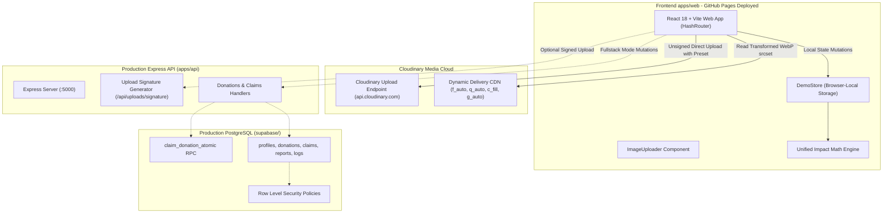

# SharePlate — Rescue Food. Reduce Waste. Feed Communities.

[](https://shebuilds.dev)
[]()
[](https://mlh.io)
[](https://cloudinary.com)
[](https://supabase.com)
[](https://pratitdedhia.github.io/SharePlate/)

> 🌐 **Live Deployed Demo:** [https://pratitdedhia.github.io/SharePlate/](https://pratitdedhia.github.io/SharePlate/)  
> 📖 **Project Journey & Hackathon Submission:** [Notion Documentation Workspace *(Pre-built in docs/notion/)*](docs/notion/00_index.md) *(Action Item: Replace with your public Notion URL before final submission)*  
> 📂 **GitHub Repository:** [https://github.com/pratitdedhia/SharePlate](https://github.com/pratitdedhia/SharePlate)

**SharePlate** is a full-stack, community-driven food rescue web application built for **Hacktober HackDays 2026** (organized by the SheBuilds Delhi Chapter and powered by Major League Hacking) under the **Tech for Social Good** track.

SharePlate bridges the critical communication gap between high-volume commercial food institutions (university canteens, banquet caterers, corporate cafeterias, and bakeries) and local community organizations (NGOs, community kitchens, shelter coordinators, and volunteer runners) to redistribute wholesome surplus food before it spoils.

---

## 🏛️ Deployed Demo vs. Production Architecture Notice

To provide instant, zero-friction evaluation for hackathon judges without requiring cloud credentials or infrastructure deployment:
- **Live Deployed Web App (`apps/web` on GitHub Pages):** Operates with `VITE_DEMO_MODE=true` using an in-browser transactional store (`demoStore`). It features a real, direct-to-Cloudinary image upload pipeline using unsigned upload presets, responsive image delivery (`srcset` at 400w/800w/1200w), food safety controls, and real measured bandwidth savings.
- **In-Repo Production Architecture (`apps/api` + `supabase/`):** A complete Node.js/Express REST API and PostgreSQL database schema with Row Level Security (RLS) policies, cryptographic SHA-based upload signature endpoints (`/api/uploads/signature`), and concurrency-safe atomic stored procedures (`claim_donation_atomic`).

---

## 📸 Overview & Key Features

- **🔐 Role-Based Food Rescue Access:** Professional authentication flows with session persistence, inline error handling, and role-based redirects.
- **⚡ 1-Click Quick Demo Access:** Instant evaluation buttons for Judges on `/login` to continue immediately as Donor, Recipient, Volunteer, or Admin with seeded personas.
- **🛡️ Strict Role-Based Dashboards & Dynamic RBAC Navigation:** Purpose-built workflows with tailored navigation for all personas:
  - **Donor:** Dashboard & My Listings (`/my-donations`); Browse Food, Impact, and About links are strictly hidden.
  - **Recipient:** Dashboard, Browse Food (`/donations`), and My Claims (`/my-claims`); Impact and About links are hidden.
  - **Volunteer:** Dedicated 3-Tab *Last-Mile Food Rescue & Rewards Hub*:
    - **1. "On-My-Way" Commute Trip Planner:** Enter origin and destination, browse nearby rescue tasks along transit corridors (Delhi NCR, Mumbai, Pune presets), select tasks with checkboxes, review sequential stop orders, and accept planned routes.
    - **2. Stop-by-Stop Checklist & Two-Party Verification:** Step-by-step navigation checklist with unlocked contact/dock notes. Enforces a strict two-party verification state machine (`Available → Accepted → Pickup awaiting confirmation → In transit → Delivery awaiting confirmation → Verified / Disputed`). Separate attributable confirmations for donor pickup and recipient NGO delivery using one-time verification codes. Points are never released on volunteer self-claim.
    - **3. Volunteer Rewards & Points Ledger:** Transparent capped rewards formula (\(\min(150, 50 + 2 \times \text{portions})\)), pending vs. released points counters, milestone progression (Bronze Courier → Silver → Gold Champion), immutable audit history, and clear disclosure of future corporate sponsor voucher concepts.
  - **Admin:** Comprehensive 5-tab Command Center: real-time analytics graphs, user account CRUD & activation controls, "Who Donated" surplus ledger with detail inspection, "Who Received" distribution ledger with status filters, and safety/allergen moderation queue.
- **🔍 Interactive Click-to-Inspect Food Cards:** Seamless navigation to listing details from card images, titles, and action buttons, presenting Cloudinary meal banners, ingredient disclosures, allergen tags, and real-time pickup countdown timers.
- **📋 Food Safety & Expiration Controls:** Prepared-at timestamps, consume-within hours, storage instructions, and veg/non-veg tags. Donations past pickup deadlines are automatically greyed out and protected against claims.
- **📸 Real Cloudinary Pipeline:**
  - Direct unsigned upload to Cloudinary via configured upload preset with client validation (JPEG/PNG/WebP, max 5 MB).
  - Server-signed upload endpoint ready when Express runs.
  - Dynamic transformations: `c_fill, g_auto, f_auto, q_auto`, responsive `srcset` (400w, 800w, 1200w), and `loading="lazy"`.
  - Real bandwidth savings measurement comparing original file size against the delivered transformed WebP blob.
  - Cloudinary provenance badge displayed strictly on images genuinely served from `res.cloudinary.com`.
- **🔒 Over-Claim & Expiration Protection:** In the deployed demo, `demoStore` prevents over-claiming and claiming expired batches. In the production backend, PostgreSQL stored procedures (`claim_donation_atomic` with `SELECT ... FOR UPDATE`) guarantee ACID concurrency safety.
- **🛡️ Privacy-Preserving Logistics:** Sensitive loading-dock access instructions and personal donor phone numbers are masked in public queries and revealed strictly to confirmed claimants.
- **📊 Unified Impact Math:** A single pure calculation engine (`apps/web/src/lib/impactMath.ts`) derives hero statistics, impact charts, and rescue rates (`delivered / listed * 100`). The funnel never contradicts the metrics.

---

## 🛠️ Technology Stack

| Layer | Technology | Details |
| :--- | :--- | :--- |
| **Frontend** | React 18, Vite, TypeScript, Tailwind CSS | Modular components, HashRouter for Pages compatibility, Rollup production bundle |
| **Media Cloud** | Cloudinary | Direct client upload preset, server signatures, auto-format (`f_auto`), smart crop (`g_auto`) |
| **Production Backend** | Node.js 24 LTS, Express, TypeScript | REST API, Zod schema validation, Helmet security headers, CORS |
| **Production Database** | PostgreSQL 15+ (Supabase) | Multi-tenant Row Level Security (RLS), atomic stored procedures (`claim_donation_atomic`) |
| **Testing** | Vitest, Node.js Test Runner | 74 frontend tests (donor rewards, volunteer trip routing, two-party claim flows, impact math, auth, upload fallback, features suite, render verification), 2 backend tests (76 total) |
| **Documentation** | Notion (Mandatory Hackathon Platform) | 12 structured markdown guides under `docs/notion/` |

---

## 🏗️ Architecture Diagram



---

## ⚡ Quickstart & Local Installation

### Prerequisites
- Node.js (v20+ LTS recommended, v24 LTS verified)
- Git

### 1. Install Workspace Dependencies
```bash
# Clone the repository
git clone https://github.com/pratitdedhia/SharePlate.git
cd SharePlate

# Install all workspace dependencies
npm ci
```

### 2. Configure Environment Variables
Copy the example files:
```bash
cp apps/api/.env.example apps/api/.env
cp apps/web/.env.example apps/web/.env
```

#### Cloudinary Setup Guide (Unsigned Upload Preset for Browser Uploads)
SharePlate supports live browser uploads directly to Cloudinary CDN using **unsigned upload presets**. This architecture allows static hosts (such as GitHub Pages) to upload food donation images securely without exposing private Cloudinary API keys or secrets in client-side code.

Follow these steps in the Cloudinary Console:
1. **Locate your Cloud Name:** Sign in to your [Cloudinary Dashboard](https://cloudinary.com/console) and copy your **Cloud Name** (shown in the Product Environment / Dashboard overview).
2. **Create an Unsigned Preset:**
   - In Cloudinary, click the **Settings** (gear icon) in the bottom left or top navigation.
   - Select **Upload** from the settings menu.
   - Scroll down to the **Upload presets** section and click **Add upload preset**.
   - Under **Preset details**, set **Signing Mode** to **Unsigned** (crucial: signed presets reject direct browser requests).
   - Enter an **Upload preset name** (or use the generated name, e.g., `shareplate_unsigned`).
   - Under **Folder**, set `shareplate/donations` (or your preferred folder).
   - *(Optional)* Under **Media analysis and AI**, enable Google Auto-Tagging if available on your add-on plan.
   - Click **Save** in the top-right corner.
3. **Configure Local Environment (`apps/web/.env`):**
   ```env
   VITE_DEMO_MODE=true
   VITE_CLOUDINARY_CLOUD_NAME=your_actual_cloud_name
   VITE_CLOUDINARY_UPLOAD_PRESET=your_unsigned_preset_name
   VITE_NOTION_URL=https://your-public-notion-page-url
   ```
4. **Configure Deployment Environment (GitHub Pages / CI):**
   - In your GitHub repository, navigate to **Settings > Secrets and variables > Actions > Variables** (tab: *Variables*).
   - Click **New repository variable** and add:
     - Name: `VITE_CLOUDINARY_CLOUD_NAME` / Value: your cloud name.
     - Name: `VITE_CLOUDINARY_UPLOAD_PRESET` / Value: your unsigned preset name.
   - GitHub Actions will inject these variables at build time during automated deployment.

> **Zero-Config Fallback & Demo Mode:**
> When credentials are not yet configured or left with `<<FILL...>>` placeholders:
> - The image uploader displays a clear pending configuration banner and keeps sample presets available.
> - Users can evaluate content-aware smart cropping (`c_fill, g_auto`) and dynamic formatting (`f_auto, q_auto`) using the pre-seeded evaluation assets.
> - Dropping or browsing a local photo falls back safely to labeled local object previews (`local_preview`) so testing continues uninterrupted.
> - If credentials are configured but the upload fails (e.g., misspelled preset or unsigned mode not enabled in dashboard), the UI validates and surfaces the error with actionable troubleshooting advice instead of silently hiding failures.

### 3. Launch Development Servers
Open two terminal windows:

**Terminal 1 (Backend API):**
```bash
cd apps/api
npm run dev
# Express API starts on http://localhost:5000
```

**Terminal 2 (Frontend Web):**
```bash
cd apps/web
npm run dev
# Vite Web App starts on http://localhost:5173
```
Open **`http://localhost:5173`** in your browser.

---

## 🧪 Automated Testing & Verification

All automated tests execute with 100% passing results across 76 tests:

### Run Backend API Tests:
```bash
npm test --workspace=@shareplate/api
# Result: 2 passed, 0 failed (Health endpoint verification)
```

### Run Frontend Unit & Integration Tests:
```bash
npm test --workspace=@shareplate/web
# Result: 89 passed, 0 failed (App, Impact Math, Donor Rewards Ledger, Volunteer Multi-Stop Route Partitioning, Two-Party Pickup & Delivery OTP Flow, Cross-Portal Sync, Auth, Upload Fallback & Error Handling, Features Suite, Render Safety)
```

### Run All Workspace Tests:
```bash
npm test
# Total: 91 passed, 0 failed
```

### Verify Production Compilation:
```bash
npm run build:web
# Compiles apps/web (tsc && vite build) and mirrors self-contained root index.html with exit code 0
```

---

## 🎬 Recommended 2–3 Minute Evaluation Demo Script

1. **Homepage & Mission Context:** Open `https://pratitdedhia.github.io/SharePlate/`. Review the mission statement, demonstration trust metrics (derived via single calculation engine), and food safety guidance.
2. **List Surplus Food (Donor):** Switch to the **Canteen / Donor** persona using the top navigation role switcher. Click **+ Donate Food** (`#/donations/new`). Upload a photo via Cloudinary or select a preloaded sample. Observe the smart auto-crop preview (`g_auto` across 4:3, 16:9, and 1:1) and real measured bandwidth savings on live upload. Enter 45 portions of *Vegetable Pulao*, set dietary tag *Veg*, allergen tags, and a 4-hour pickup deadline.
3. **Reserve Portions (NGO):** Switch persona to **NGO / Recipient** (Robin Hood Army). Browse `#/donations`. Claim 20 portions. Observe the available count drop from 45 to 25 immediately.
4. **Protected Logistics & Delivery:** Open **My Claims** (`#/my-claims`). View the revealed private pickup instructions and donor contact. Advance status: **Mark Picked Up** (`collected`), then **Confirm Delivery** (`delivered`).
5. **Impact Dashboard:** Open `#/impact`. Show the real-time portion funnel updating and the CO₂e avoided metric recalculating dynamically based on FAO/UNEP factors.

---

## 📁 Repository Structure

```
SharePlate/
├── .github/
│   └── workflows/
│       └── deploy-pages.yml    # GitHub Pages CI/CD workflow
├── apps/
│   ├── web/                    # React 18, Vite, Tailwind CSS, TypeScript frontend
│   │   ├── src/
│   │   │   ├── components/     # UI components (CloudinaryImage, ImageUploader, DemoModeBanner, etc.)
│   │   │   ├── contexts/       # AuthContext, ToastContext
│   │   │   ├── lib/            # cloudinary.ts, impactMath.ts, mockData.ts, utils.ts
│   │   │   ├── pages/          # 13 complete pages (Home, Browse, Detail, Create, Claims, Impact, etc.)
│   │   │   ├── routes/         # ProtectedRoute, RoleGuard, AppRoutes
│   │   │   ├── services/       # donations, claims, impact, uploads API services
│   │   │   └── tests/          # Vitest test suites (claimFlow, impactMath, uploadsFallback, features, renderPage)
│   │   ├── .env.example
│   │   └── package.json
│   └── api/                    # Node.js, Express, TypeScript, Zod REST API
│       ├── src/
│       │   ├── config/         # env.ts, supabase.ts, cloudinary.ts
│       │   ├── middleware/     # auth.ts, rbac.ts, validate.ts, errorHandler.ts
│       │   ├── routes/         # health, uploads, donations, claims, impact, profile, reports
│       │   └── validators/     # Zod request validation schemas
│       ├── tests/              # Node.js test runner suite
│       ├── .env.example
│       └── package.json
├── legacy/
│   └── index.html              # Preserved legacy single-file demo (archived)
├── supabase/
│   ├── schema.sql              # Complete PostgreSQL schema (tables, RLS, atomic RPCs, triggers)
│   ├── seed.sql                # Realistic Indian demo dataset (Mumbai, Delhi, Pune, Noida)
│   └── migrations/             # Timestamped migration mirror
├── docs/
│   ├── DEMO_SCRIPT.md          # 3-minute demo script & 6 judge Q&As
│   ├── NOTION_SUBMISSION_CHECKLIST.md # Notion import & submission instructions
│   ├── cloudinary.md           # Mandatory Cloudinary integration evidence
│   ├── architecture.md         # System architecture & deployment targets
│   ├── deployment.md           # Production deployment & GitHub Pages guide
│   ├── team-contributions.md   # Team task breakdown with verifiable contributions
│   └── notion/                 # 12 complete Notion-ready documentation subpages
├── CHANGES.md                  # Comprehensive record of all changes, test logs & manual steps
├── .env.example
├── .gitignore
├── LICENSE
└── package.json
```

---

## 🚧 Limitations & Production Roadmap

While SharePlate provides an end-to-end interactive experience in demo mode and complete backend code in the monorepo, real-world deployment requires the following operational milestones:

1. **Transactional OTP & SMS Gateway:** Integrate Twilio or Fast2SMS so volunteer couriers and canteen managers receive instant SMS/WhatsApp alerts for pickups without requiring an open web browser.
2. **Official NGO Verification:** In the demo, NGOs register with self-reported 80G/FCRA IDs. Production requires integrating with government registry APIs (NGO Darpan) for KYC verification.
3. **Dynamic Route Optimization:** Volunteers currently coordinate individual pickups manually. Future releases will integrate Mapbox/Google Maps Matrix API to bundle nearby pick-up stops into optimized multi-batch courier routes.
4. **Production Cloud Deployment of Express + Supabase:** Host `apps/api` on Render/Fly.io and connect with a production Supabase PostgreSQL instance with automated backups and read-replicas.
5. **Multilingual Localization (i18n):** Expand UI and donor submission forms into Hindi, Marathi, Tamil, and Bengali to support diverse regional canteen staff and grassroot volunteers.

---

## 🛡️ Food Safety Disclaimer

SharePlate is a community coordination technology platform. **SharePlate does not physically inspect, store, or certify food safety.**
- **Donors** are legally responsible under FSSAI regulations for accurate ingredient disclosures, declared allergens, and truthful preparation timestamps.
- **Recipients & Volunteers** must verify visual condition, odor, and temperature upon pickup, and distribute meals in accordance with local hygiene guidelines.

---

## 👥 Team Task Allocation

> ⚠️ **Action Item for Submitter:** Replace the bracketed role placeholders below with your team's real full names prior to final form submission. (See [docs/team-contributions.md](docs/team-contributions.md) for full task breakdown.)

- **[Team Member 1 — Full Name] (Frontend Engineering & Cloudinary Integration):**
  - Architecture of React 18 + Vite frontend, responsive layouts, and Tailwind design system.
  - Integration of Cloudinary upload component, unsigned preset support, dynamic transformations, and real bandwidth savings computation.
- **[Team Member 2 — Full Name] (Backend Architecture & Security):**
  - Node.js/Express REST API (`apps/api`), Zod request validation, role-based access control (RBAC), and cryptographic signature endpoint.
- **[Team Member 3 — Full Name] (Database Engineering & Concurrency):**
  - PostgreSQL schema design (`supabase/`), Row Level Security policies, atomic reservation stored procedures (`claim_donation_atomic`).
- **[Team Member 4 — Full Name] (QA, Documentation & Notion Journey):**
  - Automated test authoring (55 automated tests), unified impact calculation math, complete Notion documentation portfolio (`docs/notion/`), and judge demo walkthrough.

---

## 📄 License

This project is licensed under the [MIT License](LICENSE) for Hacktober HackDays 2026.