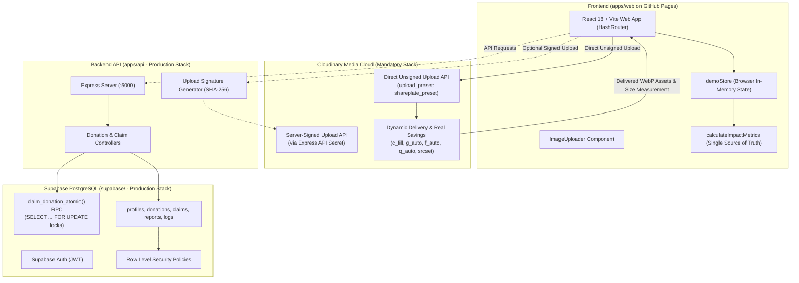

# SharePlate — System Architecture & Technical Design

**Hacktober HackDays 2026 | SheBuilds Delhi Chapter | Powered by MLH**  
**Theme:** Tech for Social Good  
**Category:** Software Development  
**Core Technologies:** React, TypeScript, Express, Supabase (PostgreSQL + Auth), Cloudinary  
**Live Deployed Target:** [https://pratitdedhia.github.io/SharePlate/](https://pratitdedhia.github.io/SharePlate/)  

---

## 1. Executive Summary

SharePlate is a community-driven, full-stack food rescue platform designed to eliminate surplus food waste generated by commercial institutions (college canteens, corporate cafeterias, caterers, banquet halls, restaurants) and redirect it immediately to nearby NGOs, community shelters, and volunteer runners.

The architecture accommodates two deployment contexts:
1. **Live Deployed Demonstration Target (GitHub Pages):** A client-side Single Page Application running `apps/web` via `HashRouter`. Integrates Cloudinary directly using an unsigned upload preset (`VITE_CLOUDINARY_UPLOAD_PRESET`), responsive transformations (`f_auto,q_auto,srcset`), and an interactive client-side engine (`demoStore`) enforcing quantity deductions and deadline expirations.
2. **Production Monorepo Target (Containerized / Cloud Deployable):** A full-stack architecture pairing `apps/web` with a Node.js/Express REST API (`apps/api`), server-signed Cloudinary uploads (`/api/uploads/signature`), and Supabase PostgreSQL (`supabase/`) featuring Row-Level Security and ACID atomic transactions (`claim_donation_atomic`).

---

## 2. High-Level Architecture Diagram

---

## 3. Component Breakdown

### 3.1 Frontend (`apps/web`)
- **Framework:** React 18, Vite, TypeScript.
- **Routing:** `HashRouter` for zero-configuration, refresh-safe hosting on GitHub Pages subpaths (`/SharePlate/#/...`).
- **Styling:** Vanilla Tailwind CSS with curated social-good tokens:
  - Deep Forest Green (`#14532d`) for sustainability and trust.
  - Emerald Green (`#10b981`) for affirmative rescue alerts.
  - Warm off-white (`#FAF9F6`) for modern, non-clinical readability.
  - Dark stone (`#1C1917`) for high-contrast accessibility.
- **Image Pipeline:** `CloudinaryImage.tsx` rendering responsive `srcset` breakpoints (400w, 800w, 1200w), `loading="lazy"`, and genuine Cloudinary badges rendered strictly when served from `res.cloudinary.com`.
- **Impact Consistency:** `impactMath.ts` calculates listed, reserved, delivered, and available portions plus rescue rates with zero contradictions across Home, Impact, and Dashboard views.

### 3.2 Backend API (`apps/api` — Production Stack)
- **Runtime:** Node.js 24 LTS, Express, TypeScript, Zod.
- **Security:** Helmet HTTP headers, CORS whitelisting, rate limiting.
- **Upload Endpoint:** `POST /api/uploads/signature` generates SHA-256 signatures for user-scoped folders (`shareplate/donations/:userId`), keeping `CLOUDINARY_API_SECRET` isolated on the server.

### 3.3 Database & Concurrency (`supabase/` — Production Stack)
- **PostgreSQL 15+ Schema:** Multi-tenant Row Level Security (RLS).
- **Atomic Stored Procedure:** `claim_donation_atomic` executes `SELECT ... FOR UPDATE` row locks to prevent overselling or race conditions during concurrent claiming.
- **Privacy View:** `public_donations` masks sensitive physical dock instructions until reservation confirmation.

---

## 4. Food Safety Data Architecture

To ensure food safety accountability without claiming laboratory food testing:
- **`prepared_at`:** ISO-8601 preparation timestamp.
- **`consume_within_hours`:** Maximum safe distribution window.
- **`storage_note`:** Environmental and temperature requirements (e.g. "Keep hot in thermal box at 60°C+").
- **`dietary_type`:** Vegetarian vs Non-Vegetarian classification.
- **Automatic Expiration:** In both `demoStore` and PostgreSQL, any batch past `pickup_deadline` transitions to `expired` status and rejects subsequent claims.
