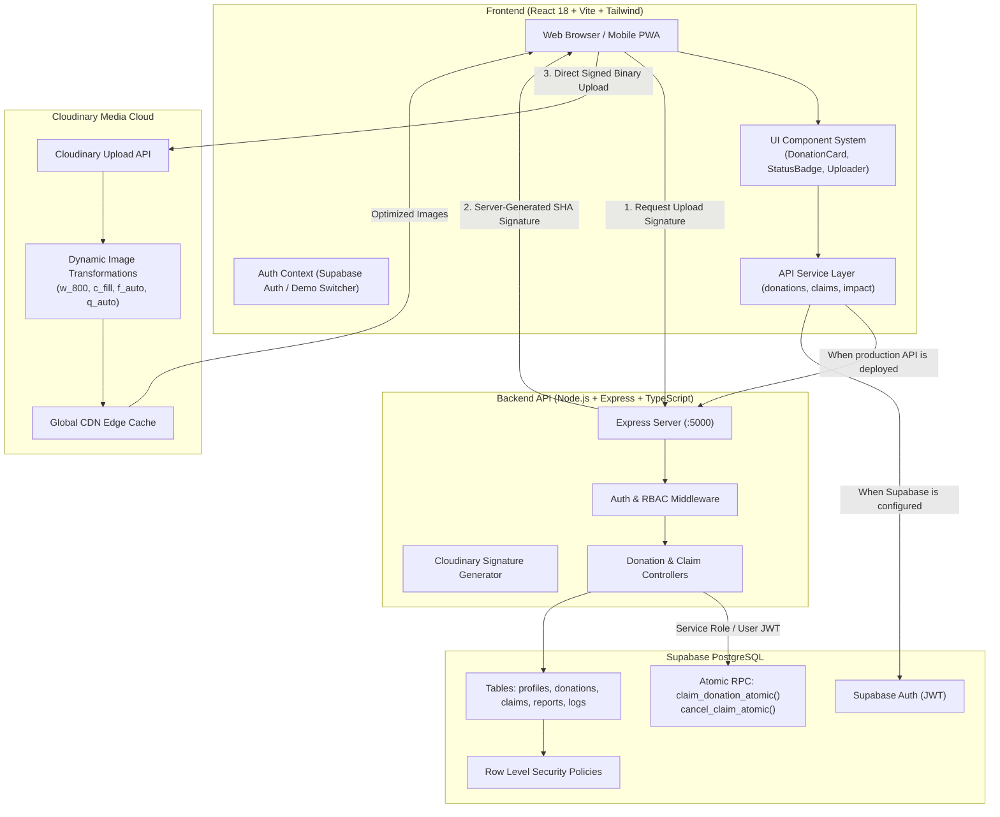

# SharePlate — System Architecture & Technical Design

**Hacktober HackDays 2026 | SheBuilds Delhi Chapter | Powered by MLH**  
**Theme:** Tech for Social Good  
**Category:** Software Development  
**Core Technologies:** React, TypeScript, Express, Supabase (PostgreSQL + Auth), Cloudinary  

## Deployment Status

The GitHub Pages workflow is configured to build `apps/web` with `VITE_DEMO_MODE=true` and publish `apps/web/dist` at `https://pratitdedhia.github.io/SharePlate/`. The Pages deployment has not been verified from this workspace. The demo uses browser-local data; Supabase and Express are repository production architecture, not deployed services.

---

## 1. Executive Summary

SharePlate is a community-driven, full-stack food rescue platform designed to eliminate surplus food waste generated by commercial institutions (college canteens, corporate cafeterias, caterers, banquet halls, restaurants) and redirect it immediately to nearby NGOs, community shelters, and volunteer runners.

The architecture prioritizes:
1. **Low-friction workflow:** The prototype supports listing, discovering, and reserving surplus batches in the browser demo.
2. **Production concurrency path:** The Supabase schema includes an atomic claim function. Browser-local demo claims do not provide cross-device or cross-tab concurrency guarantees.
3. **Data Privacy & Physical Safety:** Sensitive exact pickup instructions and donor contact phone numbers are never leaked publicly; they are exposed strictly to authorized claimants.
4. **Media options:** The static demo can upload through an unsigned Cloudinary preset; a configured Express API can issue signed parameters. Listing images use responsive Cloudinary delivery transforms when Cloudinary assets are configured.

---

## 2. High-Level Architecture Diagram

---

## 3. Component Breakdown

### 3.1 Frontend (`apps/web`)
- **Framework:** React 18 with Vite and TypeScript.
- **Styling:** Tailwind CSS with a tailored social-good palette:
  - Deep Forest Green (`#14532d`) for trust and sustainability.
  - Emerald Green (`#10b981`) for accents and positive confirmation.
  - Warm off-white surfaces (`#FAF9F6`) for modern, non-sterile aesthetics.
  - Dark charcoal text (`#1C1917`) for accessible contrast ratios.
- **Routing & Guards:** React Router 6 with `ProtectedRoute` and `RoleGuard` restricting actions by persona (Donor, Recipient, Volunteer, Admin).
- **Interactive Evaluation Switcher:** Enables hackathon judges to toggle personas in one click without re-logging.

### 3.2 Backend API (`apps/api`, repository only for the Pages demo)
- **Runtime:** Node.js 24 LTS, Express, TypeScript, Zod.
- **Security:** Helmet HTTP headers, CORS origin whitelisting, rate limiting.
- **Upload Endpoint:** `POST /api/uploads/signature` generates SHA signatures for direct client uploads, keeping the `CLOUDINARY_API_SECRET` strictly on the server.
- **Atomic Operations:** The production claim path can invoke PostgreSQL procedures. The static demo does not call that path.

### 3.3 Media Pipeline (Cloudinary)
- **Role:** Mandatory technology for Hacktober HackDays 2026.
- **Uploads:** Unsigned upload preset in the static demo; server-signed parameters are available when the API is deployed and configured.
- **Delivery:** Responsive image transforms (`c_fill,g_auto,f_auto,q_auto`) with 400/800/1200 `srcset` widths.
- **Fallback:** Missing Cloudinary configuration produces a labeled local preview, not a Cloudinary upload.

### 3.4 Database & Security (Supabase PostgreSQL)
- **Row Level Security (RLS):** Strict multi-tenant isolation.
- **Public View:** `public_donations` view strips sensitive pickup notes from unreserved queries.
- **Concurrency Isolation:** `SELECT ... FOR UPDATE` row-level locks prevent race conditions during high-concurrency reservation events.
