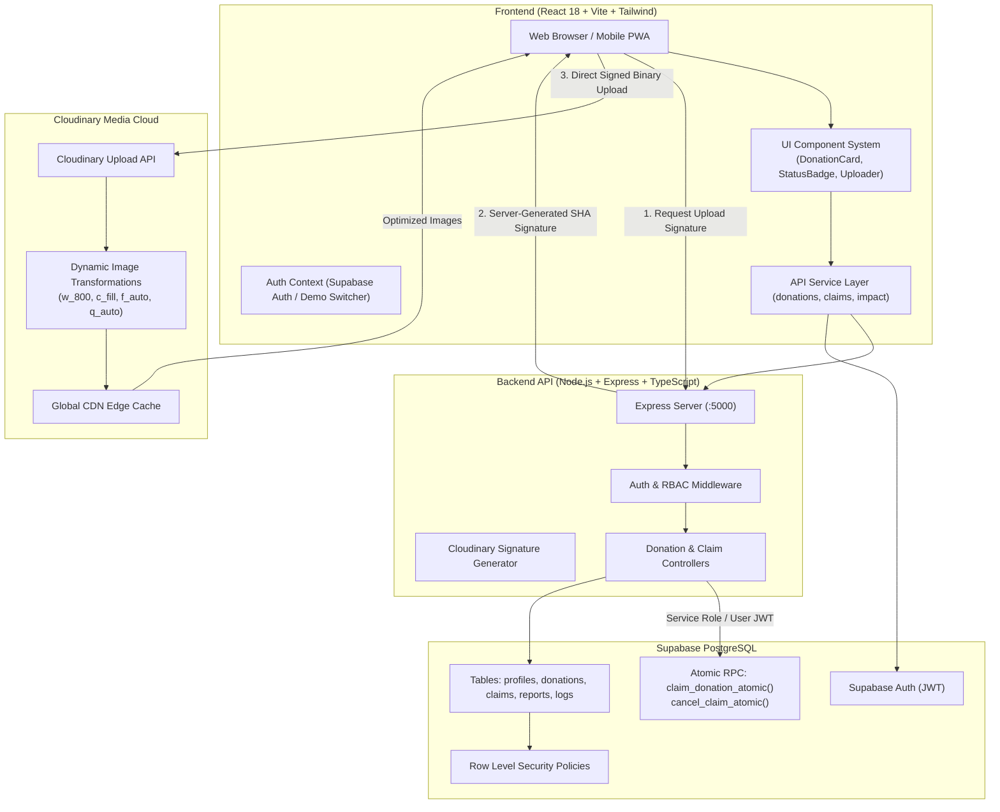

# SharePlate — System Architecture & Technical Design

**Hacktober HackDays 2026 | SheBuilds Delhi Chapter | Powered by MLH**  
**Theme:** Tech for Social Good  
**Category:** Software Development  
**Core Technologies:** React, TypeScript, Express, Supabase (PostgreSQL + Auth), Cloudinary  

---

## 1. Executive Summary

SharePlate is a community-driven, full-stack food rescue platform designed to eliminate surplus food waste generated by commercial institutions (college canteens, corporate cafeterias, caterers, banquet halls, restaurants) and redirect it immediately to nearby NGOs, community shelters, and volunteer runners.

The architecture prioritizes:
1. **Low Latency & High Speed:** Cooked food spoils quickly. Posting, discovering, and reserving surplus batches takes under 60 seconds.
2. **Concurrency Safety:** Concurrency-safe atomic reservations prevent two NGOs from claiming the same portions.
3. **Data Privacy & Physical Safety:** Sensitive exact pickup instructions and donor contact phone numbers are never leaked publicly; they are exposed strictly to authorized claimants.
4. **Optimized Media Pipeline:** Cloudinary handles cryptographic server-signed uploads, automatic responsive transformations, and format optimization (f_auto, q_auto) to ensure rapid loading on mobile networks.

---

## 2. High-Level Architecture Diagram

---

## 3. Component Breakdown

### 3.1 Frontend (`apps/web`)
- **Framework:** React 18 with Vite and TypeScript.
- **Styling:** Tailwind CSS with a tailored social-good palette:
  - Deep Forest Green (`#14532d`) for trust and sustainability.
  - Emerald Green (`#10b981`) for accents and positive confirmation.
  - Warm off-white surfaces (`#FAF9F6`) for modern, non-sterile aesthetics.
  - Dark charcoal text (`#1C1917`) for accessible contrast ratios.
- **Routing & Guards:** React Router 6 with `ProtectedRoute` and `RoleGuard` restricting actions by persona (Donor, Recipient, Volunteer, Admin).
- **Interactive Evaluation Switcher:** Enables hackathon judges to toggle personas in one click without re-logging.

### 3.2 Backend API (`apps/api`)
- **Runtime:** Node.js 24 LTS, Express, TypeScript, Zod.
- **Security:** Helmet HTTP headers, CORS origin whitelisting, rate limiting.
- **Upload Endpoint:** `POST /api/uploads/signature` generates SHA signatures for direct client uploads, keeping the `CLOUDINARY_API_SECRET` strictly on the server.
- **Atomic Operations:** Routes invoke PostgreSQL stored procedures to guarantee ACID isolation during quantity reservations.

### 3.3 Media Pipeline (Cloudinary)
- **Role:** Mandatory technology for Hacktober HackDays 2026.
- **Folder Scoping:** Restricted to `shareplate/donations/<userId>/`.
- **Delivery:** Responsive image transforms (`c_fill,w_800,h_600,f_auto,q_auto`).
- **Resilience:** Automatic fallback to verified demo food photography if credentials are absent.

### 3.4 Database & Security (Supabase PostgreSQL)
- **Row Level Security (RLS):** Strict multi-tenant isolation.
- **Public View:** `public_donations` view strips sensitive pickup notes from unreserved queries.
- **Concurrency Isolation:** `SELECT ... FOR UPDATE` row-level locks prevent race conditions during high-concurrency reservation events.
