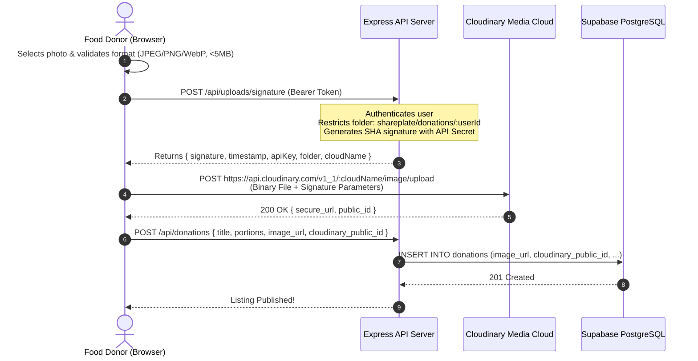

# SharePlate — Cloudinary Integration Architecture

**Hacktober HackDays 2026 Mandatory Technology**  
**Role:** End-to-End Visual Verification & Responsive Media Delivery Pipeline  

---

## 1. Why Cloudinary is Critical for SharePlate

In community food rescue, visual inspection is paramount:
1. **Sensory Verification:** Recipients (NGO coordinators and community kitchen heads) need to verify freshness, packaging integrity, and portion volume before dispatching volunteers.
2. **Mobile Network Performance:** Many volunteers and shelters operate in areas with fluctuating mobile cellular connectivity. Uncompressed mobile camera uploads (often 4MB–8MB) cause severe delays. Cloudinary compresses payloads by up to 70% with zero perceptible quality degradation.
3. **Security:** By utilizing Cloudinary's signed upload architecture, our Express API never handles heavy multipart file binary streams directly, eliminating server disk I/O bottlenecks and denial-of-service risks.

---

## 2. Cryptographically Signed Upload Workflow



---

## 3. Dynamic Transformations & Delivery Optimization

SharePlate leverages Cloudinary's dynamic URL transformations on all listing views:

### 3.1 Listing Cards (`DonationCard.tsx`)
```
https://res.cloudinary.com/:cloud/image/upload/c_fill,w_600,h_400,g_auto,q_auto,f_auto/:publicId
```
- `c_fill,w_600,h_400`: Ensures uniform aspect ratios across all cards, preventing layout shifts.
- `g_auto`: AI-assisted gravity focuses the crop on the main subject (the food tray).
- `q_auto`: Automatically adjusts compression level based on image content.
- `f_auto`: Automatically selects the most modern format supported by the client browser (e.g., AVIF or WebP on Chrome, JPEG on older clients).

### 3.2 Detail View (`DonationDetailPage.tsx`)
```
https://res.cloudinary.com/:cloud/image/upload/c_fill,w_1000,h_600,g_auto,q_auto,f_auto/:publicId
```

---

## 4. Security & Isolation Controls

1. **Secret Isolation:** `CLOUDINARY_API_SECRET` resides strictly in `apps/api/.env` and is never bundled in frontend assets.
2. **User-Scoped Folders:** Uploads are scoped to `shareplate/donations/<userId>/`, preventing users from overwriting or tampering with other donors' images.
3. **Size & Type Constraints:** Pre-upload checks reject files larger than 5MB or non-image MIME types.
4. **Resilience & Fallback:** If Cloudinary credentials are not configured in local development, SharePlate automatically supplies high-resolution sample presets with Unsplash CDNs, allowing judges to test without blockers.

---

## 5. Environment Configuration

### Backend (`apps/api/.env`)
```bash
CLOUDINARY_CLOUD_NAME=your_cloud_name
CLOUDINARY_API_KEY=your_api_key
CLOUDINARY_API_SECRET=your_api_secret
CLOUDINARY_FOLDER=shareplate/donations
CLOUDINARY_MAX_FILE_SIZE_MB=5
```

### Frontend (`apps/web/.env`)
```bash
VITE_CLOUDINARY_CLOUD_NAME=your_cloud_name
```
