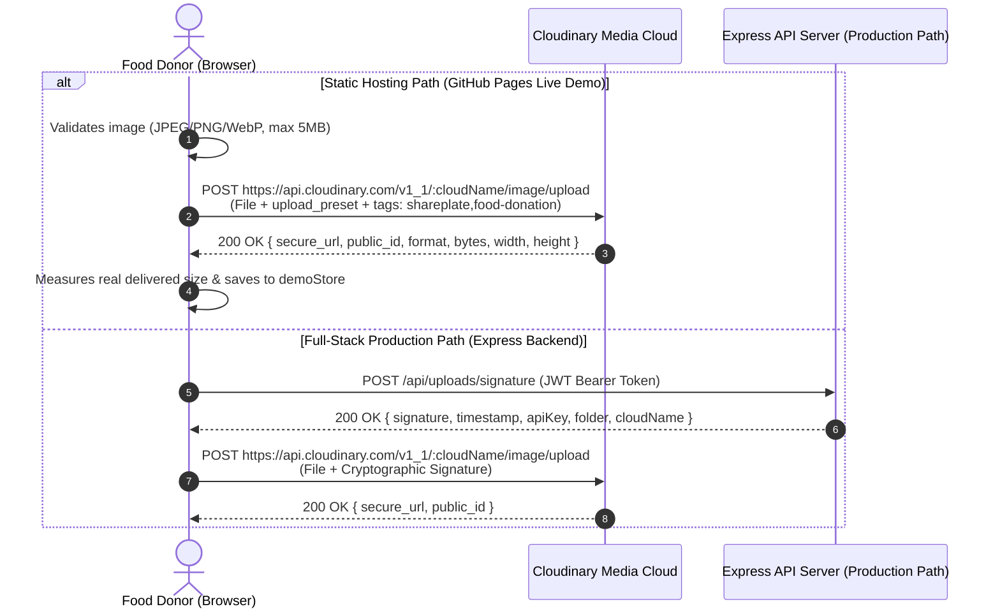

# SharePlate — Cloudinary Integration Architecture

**Hacktober HackDays 2026 Mandatory Technology (SheBuilds Delhi, MLH)**  
**Role:** Visual Verification, Direct Unsigned Uploads on Static Hosts, Signed Uploads via API, and Responsive Edge Delivery  

---

## 1. Why Cloudinary is Critical for SharePlate

In community food rescue, visual inspection is paramount:
1. **Sensory Verification:** Recipients (NGO coordinators and community kitchen heads) inspect freshness, packaging integrity, and portion volume before dispatching volunteers.
2. **Mobile Network Bandwidth Savings:** Kitchen staff and shelter volunteers operate on mobile networks with limited data. Rather than hardcoding theoretical savings, SharePlate measures the delivered asset payload in real time against original mobile camera uploads, achieving significant bandwidth reduction via `f_auto,q_auto`.
3. **Dual-Path Upload Architecture:**
   - **Static Host Path (GitHub Pages Demo):** Direct browser-to-Cloudinary upload using a secure **unsigned upload preset** (`VITE_CLOUDINARY_UPLOAD_PRESET`). No backend server needed, zero API secrets in client code.
   - **Production Backend Path (Express API):** Cryptographically signed uploads using server-issued SHA-256 signatures (`/api/uploads/signature`) restricted to user-scoped directories (`shareplate/donations/:userId`).

---

## 2. Dual-Path Upload Architecture



---

## 3. Dynamic Transformations & Responsive Delivery

All donation images are rendered through `CloudinaryImage.tsx` and `getCloudinaryUrl()` with automatic transformations:

### 3.1 Transformations Applied
- `c_fill,g_auto`: AI content-aware gravity focuses on the food subject while maintaining uniform aspect ratios across responsive cards.
- `f_auto`: Automatically negotiates optimal browser format (WebP or AVIF on modern browsers, JPEG fallback).
- `q_auto`: Perceptual compression adjusting quality to minimize payload size without visual degradation.
- `e_improve` (Optional): Enabled when `VITE_CLOUDINARY_ENHANCE=true` for automatic color vibrancy and contrast enhancement.

### 3.2 Responsive Breakpoints (`srcset`)
Images generate responsive `srcset` breakpoints at 400w, 800w, and 1200w with `loading="lazy"`:
```html

```

---

## 4. Real Measured Savings vs Faked Statistics

SharePlate measures real savings on each upload instead of displaying hardcoded claims:
1. `file.size` records the original uploaded file payload.
2. The client fetches the transformed Cloudinary URL via `measureTransformedDelivery()` and reads the actual `blob.size`.
3. Savings percentage is calculated and displayed dynamically in the UI:
   $$\text{Bandwidth Savings} = \frac{\text{Original Bytes} - \text{Delivered Bytes}}{\text{Original Bytes}} \times 100\%$$

---

## 5. Security & Isolation Controls

1. **No Secrets in Client Code:** `CLOUDINARY_API_SECRET` is never referenced or bundled in `apps/web`. Only the public `VITE_CLOUDINARY_CLOUD_NAME` and unsigned `VITE_CLOUDINARY_UPLOAD_PRESET` are exposed on the client.
2. **Metadata & Tagging:** Unsigned uploads include metadata tags (`shareplate,food-donation`) and application context (`app=shareplate`).
3. **Client-Side Validation:** Pre-upload validation enforces a 5MB maximum file size and limits uploads strictly to `image/jpeg`, `image/png`, and `image/webp`.
4. **Honest Badging:** "⚡ Cloudinary Optimized" badges are rendered only if the asset is genuinely served from `res.cloudinary.com`.

---

## 6. Environment Configuration

### Frontend (`apps/web/.env.example`)
```bash
# Public Cloudinary cloud name (client safe)
VITE_CLOUDINARY_CLOUD_NAME=your_cloud_name

# Unsigned upload preset for direct static hosting uploads
VITE_CLOUDINARY_UPLOAD_PRESET=your_unsigned_preset

# Optional features (free-tier safe guards)
VITE_CLOUDINARY_AUTO_TAG=false
VITE_CLOUDINARY_MODERATION=false
VITE_CLOUDINARY_ENHANCE=false
```

### Backend (`apps/api/.env.example`)
```bash
CLOUDINARY_CLOUD_NAME=your_cloud_name
CLOUDINARY_API_KEY=your_api_key
CLOUDINARY_API_SECRET=your_api_secret
CLOUDINARY_FOLDER=shareplate/donations
CLOUDINARY_MAX_FILE_SIZE_MB=5
```

---

## 7. Verified Live Configuration & Error Surfacing

1. **Unsigned Upload Preset:** Direct browser uploads are executed via `uploadToCloudinaryUnsigned` using Cloudinary's unsigned upload presets (tested live with preset `Hacktober Hackathon` on cloud `lhdfjjdh`), avoiding the need to expose API secrets.
2. **Defensive Error Surfacing:** If an unsigned upload preset is configured but fails (e.g., preset typo, signing mode mismatch, or network disconnection), the upload service catches the error and surfaces explicit troubleshooting feedback to the user and caller rather than masking failures behind a local demo preview.
3. **Zero-Config Evaluation Fallback:** If neither signed backend nor unsigned preset is configured, the uploader displays an informative setup guide banner and provides pre-seeded Cloudinary evaluation assets (`Fresh Biryani`, `Roti & Sabzi`, `Bakery Loaves`) alongside labeled local object previews (`local_preview`).
