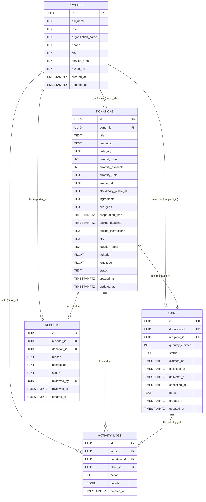

# SharePlate — Database Design & Schema Documentation

**Database Engine:** PostgreSQL 15+ (Hosted on Supabase)  
**Security Model:** Row Level Security (RLS) + SECURITY DEFINER RPCs  
**Concurrency Strategy:** `SELECT ... FOR UPDATE` row locking for race condition prevention  

---

## 1. Entity Relationship (ER) Overview

---

## 2. Table Specifications

### 2.1 `profiles`
Stores user identity metadata linked directly to Supabase Auth (`auth.users.id`).
- Allowed roles: `donor`, `recipient`, `volunteer`, `admin`.
- Auto-created via PostgreSQL trigger `on_auth_user_created` whenever a user registers.
- RLS Policy: Anyone can view public profile fields; users can only modify their own profile.

### 2.2 `donations`
Stores food listings published by commercial kitchens.
- Constraints:
  - `quantity_total > 0`
  - `quantity_available >= 0`
  - `chk_quantity_available_lte_total`: `quantity_available <= quantity_total`
  - Status check: `available`, `reserved`, `claimed`, `collected`, `delivered`, `expired`, `cancelled`.
- Sensitive column `pickup_instructions` is masked in public views to prevent leaking private residential or back-dock access codes to unverified browsers.

### 2.3 `claims`
Tracks individual portion reservations made by NGOs or community kitchens.
- Status lifecycle: `claimed` → `collected` → `delivered` (or `cancelled`).
- Timestamps recorded for each state transition to calculate transit time and delivery velocity.

### 2.4 `reports` & `activity_logs`
- Provides platform oversight for food hygiene flags and audit trail for every portion reservation and state change.

---

## 3. Concurrency Safety & Stored Procedures

### `claim_donation_atomic(p_donation_id, p_recipient_id, p_quantity, p_notes)`
1. Acquires an exclusive row-level lock on `donations` using `SELECT ... FOR UPDATE`.
2. Validates that the pickup deadline has not expired (`pickup_deadline > NOW()`).
3. Confirms that `quantity_available >= p_quantity`.
4. Decrements `quantity_available`.
5. Automatically marks donation status as `reserved` if remaining quantity equals 0.
6. Inserts the new claim into `claims`.
7. Records audit entry in `activity_logs`.
8. Returns the verified reservation payload as `JSONB`.

### `cancel_claim_atomic(p_claim_id, p_user_id, p_reason)`
1. Verifies caller is either the claim recipient or the listing donor.
2. Acquires row lock on both the claim and donation.
3. Sets claim status to `cancelled` with timestamp.
4. Restores `quantity_available = quantity_available + quantity_claimed`.
5. Transitions donation status back to `available` if the deadline is still in the future.
